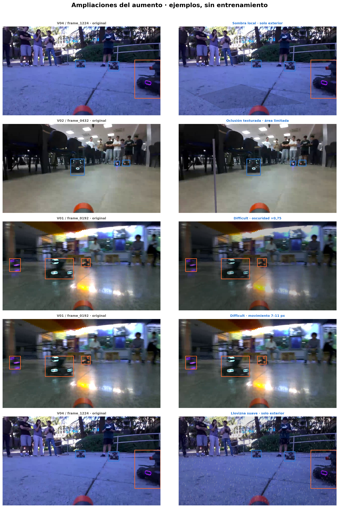

# Ampliaciones experimentales del aumento

Implementación de T14/T19 en la sección 9 de [`data_aug.ipynb`](../../data_aug.ipynb)
y en [`aumento_robusto.py`](../../../../herramientas/aumento_robusto.py).
Son hipótesis por comparar en validación: no se ha entrenado con estos perfiles.

| `PERFIL_AUMENTO` | Qué cambia |
|---|---|
| `base` (predeterminado) | Conserva el aumento usado en los entrenamientos actuales |
| `sombras_v1` | Una sombra local con multiplicador 0,65–0,85; probabilidad 25 % solo en V04/V09 |
| `oclusion_v1` | Sustituye las barras lisas por uno o dos postes con textura, gradiente y anchura variable; probabilidad 15 % |
| `difficult_v1` | La primera copia de una imagen con difficult puede recibir oscuridad ×0,70–0,85 o movimiento de 7–11 px; probabilidad 50 % |
| `lluvia_v1` | Llovizna, ancho de gota 1 px, desenfoque 3 y brillo ×0,9; probabilidad 15 % solo en V04/V09, salvo copias con barras base |
| `robusto_v1` | Las cuatro ampliaciones; sombra y lluvia son excluyentes, y la lluvia excluye también oclusión y refuerzo difficult |

Las probabilidades son de configuración; la frecuencia observada depende de las
imágenes elegibles y del sorteo. La lluvia individual conserva la oclusión base y
se omite cuando esta ya se aplicó. Su frecuencia efectiva es menor que el 15 %.
El refuerzo se dirige a **imágenes que conservan alguna caja difficult después de
la geometría**, no solo a los píxeles de esas cajas. No se añade otro MotionBlur
si ya aparece entre las transformaciones base.

Se conservan los originales y tres copias por imagen: no hay sobremuestreo de
difficult. Las otras copias reciben el aumento base y pueden recibir otros extras;
el original es la muestra limpia. No se cambian los flags con efectos fotométricos.

La oclusión limita la **unión acumulada de máscaras**, incluido el borde suave,
al 25 % del área de cada caja. No es una segmentación del robot: esa cifra no
garantiza que quede visible el 75 % de su cuerpo. Los obstáculos son procedurales,
no fotografías, y siguen siendo una aproximación que requiere revisión visual.

## Ejemplos y exportación



La lámina fuerza cada efecto sobre originales para facilitar su inspección; no
representa las probabilidades ni la combinación que recibe cada copia real.
Azul: caja normal. Naranja: difficult. Las cajas se mantienen en estos ejemplos
porque ninguna de las ampliaciones mueve la imagen.

- [PNG para Word](ampliaciones_aumento.png), 200 ppp.
- [PDF para la memoria](ampliaciones_aumento.pdf). Las fotografías siguen siendo
  rasterizadas junto con sus cajas dentro del PDF; los títulos son texto vectorial.

Para regenerar solo la lámina, ejecutar la configuración, carga, funciones de
aumento y la celda de ejemplos de la sección 9. No ejecutar la sección 5 si solo
se quieren consultar ejemplos.

## Uso en un futuro entrenamiento

1. Instalar `albumentations==1.4.18` y `albucore==0.0.17` en el entorno del notebook
   si no están instalados. Se usa la API de esa versión.
2. Seleccionar un perfil en la configuración y ejecutar el notebook. Genera
   `datasets_experimentos/<perfil>/data_train/` y copias sin aumento de val/test en
   el mismo destino. Solo entrenamiento recibe copias aumentadas.
3. Apuntar `local_path` del entrenamiento a `datasets_experimentos/<perfil>` y
   usar un sufijo nuevo. La evaluación debe cargar el modelo de ese experimento
   y usar exclusivamente validación mientras se elige la configuración.
4. Comparar primero un perfil individual con `base`, manteniendo lr, semilla,
   épocas y número de copias. El conjunto `robusto_v1` mide el efecto de la
   combinación y no permite atribuir mejoras a una técnica concreta.

Los destinos y resultados se separan del base. La marca del dataset guarda perfil
y configuración; el manifiesto registra semilla, índice de copia y transformaciones.
Los datasets experimentales están ignorados en Git. No se suben pesos ni copias
aumentadas individuales; las imágenes versionadas aquí son láminas de resultados.

## Comprobaciones y límites

`manifest_comprobacion_robusto_v1.csv` y `comprobacion_robusto_v1.json` documentan
la comprobación en memoria de las tres copias de cada original depurado. No son
resultados de un entrenamiento ni implican que exista un dataset nuevo en disco.

Resultado: **796 originales, 2388 copias y 4167 cajas conservadas de 4197**
(pérdida del 0,715 %, igual al aumento base). Se comprobaron las cajas de todas
las copias y se reprodujeron exactamente 24. El combinado produjo 109 sombras
(58 en V04 y 51 en V09), 62 lluvias (34 y 28), 347 oclusiones texturadas,
75 copias difficult oscuras y 53 con movimiento adicional. Ninguna oclusión superó
el límite de área. Las versiones concretas están en el JSON; no se calculó mAP.

Pruebas de regresión, desde la raíz del repositorio y con las dependencias del
notebook instaladas:

```bash
python -m pytest herramientas/tests/test_aumento_robusto.py -q
```

Comprueban la selección de exteriores, las exclusiones entre efectos, la selección
de copias difficult, el límite acumulado de oclusión incluso en cajas pequeñas,
la reproducibilidad y que lluvia/sombra no modifiquen la imagen original en memoria.

La comprobación de datos no demuestra una mejora de mAP. Tampoco la lluvia sintética
demuestra funcionamiento bajo lluvia real: necesitaríamos imágenes reales de esa
condición para sostener esa conclusión. No se ha evaluado test ni modificado el
entrenamiento lr001.

Referencia de la API: [código de Albumentations 1.4.18](https://github.com/albumentations-team/albumentations/blob/1.4.18/albumentations/augmentations/transforms.py).
