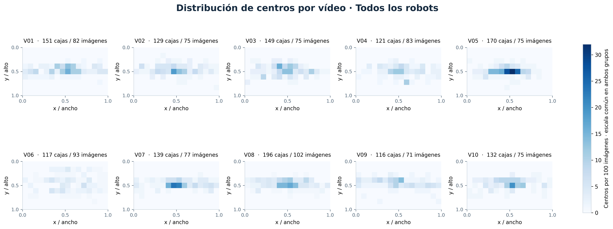
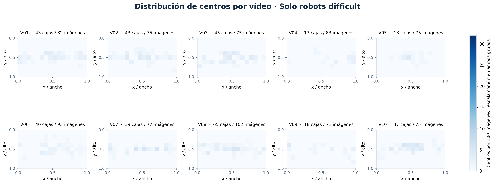
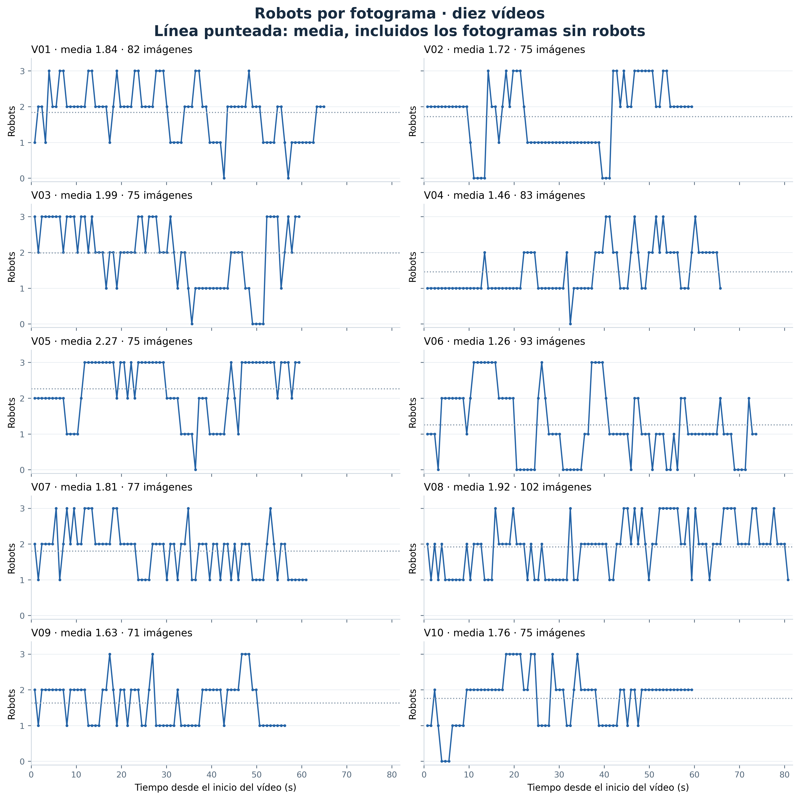

# Resultados del EDA

Figuras y tablas que genera [`eda.ipynb`](../eda.ipynb) (T11 y T12). Se sobrescriben
cada vez que se ejecuta el notebook, así que **no se editan a mano**: si cambian las
etiquetas, se vuelve a ejecutar el notebook y se revisan sus comentarios. Las cifras
actuales corresponden a las etiquetas del 12/10/2026.

## Figuras recomendadas para la memoria

La memoria tiene un máximo de 10 páginas de cuerpo. Estas seis figuras cuentan la
historia completa del EDA; las demás pueden ir a un anexo o citarse con sus cifras.

| Figura | Qué muestra | Pie de figura propuesto |
|---|---|---|
| `ejemplos_secuencias.jpg` | Un fotograma por vídeo con sus cajas | Fotograma con más robots de cada secuencia. En azul, robots normales; en naranja, `difficult`. |
| `imagenes_y_cajas_por_secuencia.png` | Imágenes y robots (normales y `difficult`) por vídeo | Reparto de las 808 imágenes y los 1420 robots entre las diez secuencias. |
| `acuerdo_anotadores.png` | IoU entre parejas, discrepancia por borde y sesgo de cada anotador | Acuerdo entre los cinco anotadores en las 20 imágenes de calibración. El borde superior concentra las discrepancias. |
| `mapa_calor_centros.png` | Posición de los centros de las cajas | Los robots aparecen en una franja horizontal a media altura y simétrica, lo que justifica el volteo horizontal y descarta el vertical. |
| `forma_cajas.png` | Tamaño, relación de aspecto e IoU con las anclas | Las cajas son casi cuadradas y las anclas por defecto de Faster R-CNN cubren el 99,6 % con IoU ≥ 0,5. |
| `linea_temporal.png` | Cada fotograma en su instante del vídeo: robots, poco nítidos y casi duplicados | Mapa de la depuración: los negativos y los fotogramas movidos llegan en tramos. |

## Todas las figuras

| Sección del notebook | Figura | Qué muestra |
|---|---|---|
| 1 | `ejemplos_secuencias.jpg` | Fotograma con más robots de cada vídeo |
| 2 | `imagenes_y_cajas_por_secuencia.png` | Imágenes y cajas (normales y `difficult`) por vídeo |
| 3 | `area_cajas_por_secuencia.png` | Histograma logarítmico del área, con los límites de tamaño de COCO |
| 4 | `rgb_por_secuencia.png` | Valor medio de R, G y B por imagen; los exteriores se separan por su tono azulado |
| 5 | `acuerdo_anotadores.png` | Matriz de IoU entre anotadores, discrepancia por borde y sesgo de tamaño |
| 6 | `perspectiva.png` | Alto de la caja frente a la posición de su base, con las cajas atípicas |
| 6 | `perspectiva_atipicas.jpg` | Las ocho cajas más atípicas, revisadas a ojo: son correctas |
| 7 | `solapamiento_cajas.png` | IoU entre robots de una misma imagen frente al umbral de NMS |
| 8 | `robots_por_imagen.png` | Distribución del número de robots por imagen |
| 9 | `mapa_calor_centros.png` | Mapa de calor de los centros y altura del centro |
| 10 | `forma_cajas.png` | Ancho y alto, relación de aspecto y mejor IoU con las anclas |
| 11 | `diversidad_visual.png` | PCA de las miniaturas, un panel por escenario |
| 12 | `nitidez_por_secuencia.png` | Varianza del Laplaciano por vídeo, con los fotogramas apuntados como movidos |
| 12 | `nitidez_candidatas.jpg` | Las seis imágenes menos nítidas que no estaban en casos dudosos |
| 13 | `diferencia_consecutivos.png` | Diferencia entre cada fotograma y el anterior |
| 13 | `pares_mas_parecidos.jpg` | Los pares casi idénticos de tres secuencias |
| 14 | `linea_temporal.png` | Línea temporal de los fotogramas de cada vídeo |

Las figuras con fotogramas se guardan en JPEG y las gráficas en PNG, a 200 ppp.

## Ampliación espacial y temporal (15/10/2026)

La sección 9 de `eda.ipynb` añade tres figuras interactivas. El cálculo y el diseño
están en [`herramientas/visualizaciones_eda.py`](../../../herramientas/visualizaciones_eda.py).
Se usan las **808 imágenes originales, 1420 cajas y 375 `difficult`**, antes de la
depuración. No se modifica el entrenamiento ni se usan validación o test.

| Interactivo | Qué permite explorar | Vista para el informe |
|---|---|---|
| [Mapas por vídeo](interactivos/mapas_calor_por_video.html) | Seleccionar V01–V10 y comparar todos con `difficult` | `para_informe/mapa_calor_por_video_todos.*` y `mapa_calor_por_video_difficult.*` |
| [Mapas temporales](interactivos/mapas_calor_temporales.html) | Recorrer 132 ventanas de 5 segundos, con reproducción, pausa y salto al inicio de un vídeo | `para_informe/mapas_temporales_V01.*` a `mapas_temporales_V10.*` |
| [Recuentos por fotograma](interactivos/robots_por_fotograma.html) | Los diez vídeos avanzan a la vez por las 102 posiciones de muestreo; cada panel muestra el número de robots de su imagen | `para_informe/robots_por_fotograma_videos.*` |

### Método y límites

- Los mapas son histogramas de **centros** en una cuadrícula de 16 × 9, con ejes
  normalizados y el origen en la esquina superior izquierda. No representan el
  área cubierta por las cajas.
- La unidad es **centros por 100 imágenes anotadas** del vídeo o intervalo. Se
  incluyen las negativas en el denominador. `Difficult` es un subconjunto de
  «todos»; una celda nunca tiene más `difficult` que robots totales. No es un
  porcentaje de cajas ni una probabilidad: la suma puede superar 100.
- La escala de color es fija entre vídeos y entre los dos grupos. Los mapas de
  vídeos completos y los temporales usan máximos propios: para comparar una
  figura con otra se consulta su barra de color.
- Ventanas disjuntas `[0,5)`, `[5,10)`, etc., calculadas con `frame / 30,303`. La
  última puede tener menos imágenes. Se muestran los contadores para no confundir
  una frecuencia alta basada en pocas muestras con un patrón persistente.
- Los fotogramas se anotaron cada **24 frames (~0,79 s)**. La animación avanza por
  esas muestras; no inventa los fotogramas intermedios ni sigue identidades.
- Los recuentos incluyen los fotogramas sin robots como cero. La línea punteada
  indica la media de cada vídeo completo; al terminar una grabación la curva se
  detiene, sin añadir ceros. Media global: **1,76**; V05: **2,27**; V06: **1,26**.
- Una ventana sin `difficult` se muestra vacía. Las concentraciones describen las
  grabaciones y no prueban dónde aparecerán robots en otros escenarios.

### Exportación para Word y PDF

La sección **«Exportación de las nuevas figuras para Word y PDF»** del notebook
genera **13 figuras × 3 formatos** en `para_informe/`:

- **PNG, 300 ppp:** para insertar directamente en Word sin comprimir la imagen.
- **SVG:** vectorial para Word compatible y edición.
- **PDF:** vectorial para el informe o como anexo.

No se necesita Kaleido: las versiones estáticas se dibujan con Matplotlib sobre
los mismos datos. Cada hoja temporal conserva los dos grupos, intervalo a
intervalo, y la misma escala temporal que la animación.

Para abrir los interactivos, descarga `interactivos/` junto con `para_informe/` y
abre [`interactivos/indice.html`](interactivos/indice.html). La biblioteca
`plotly.min.js` se incluye una sola vez y permite usarlos sin conexión. GitHub
muestra el código HTML, por lo que las vistas anteriores son PNG.
Datos auditables: [`recuentos_fotogramas.csv`](interactivos/recuentos_fotogramas.csv)
y [`recuentos_ventanas.csv`](interactivos/recuentos_ventanas.csv).

**Pies propuestos:**

- **Mapas por vídeo:** «Distribución de los centros de las cajas por vídeo,
  expresada en centros por 100 imágenes. Todos los robots y `difficult` comparten
  escala de color; se incluyen las imágenes sin robots en la normalización».
- **Mapas temporales:** «Evolución espacial en intervalos de 5 segundos de VXX.
  Cada pareja compara todos los robots y los `difficult`; se indican las cajas y
  las imágenes observadas en cada intervalo».
- **Recuentos:** «Número de robots por fotograma anotado en los diez vídeos. La
  línea punteada indica la media de cada secuencia, incluyendo los negativos».

## Tablas

| Tabla | Contenido | Uso |
|---|---|---|
| `resumen_secuencias.csv` | Por vídeo: escenario, imágenes, robots, `difficult`, negativas y porcentajes | Tabla del dataset en la memoria |
| `tamano_cajas.csv` | Porcentaje de cajas pequeñas, medianas y grandes (COCO) por vídeo | Sección de análisis del tamaño |
| `cajas_atipicas.csv` | Las 15 cajas que no encajan con la perspectiva de su vídeo | Revisión en la depuración (T13) |
| `metricas_imagenes.csv` | Una fila por imagen: color, brillo, contraste, nitidez, diferencia con la anterior y marcas de candidata | **Entrada de la depuración (T13)** |

En `metricas_imagenes.csv`, las columnas `candidata_nitidez` (`nitidez_rel < 0,35`) y
`casi_duplicada` (diferencia con la anterior < 5) marcan imágenes **para revisar a
ojo**, no para borrar automáticamente: varias de las menos nítidas muestran piezas de
nuestro propio robot y son negativos difíciles que conviene conservar.

## Nota sobre los nombres

`acuerdo_anotadores.png` muestra el nombre de cada integrante. Si en la memoria se
prefiere anonimizar el acuerdo, basta con cambiar los valores del diccionario
`NOMBRES` del notebook (por ejemplo, por `A`-`E`) y volver a ejecutarlo.
