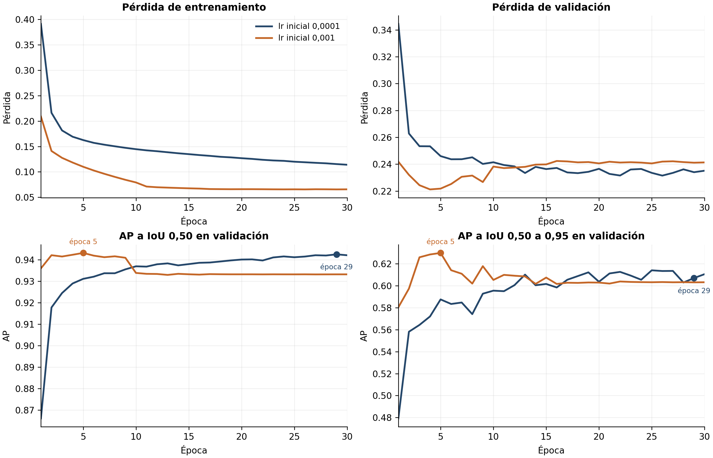

# Comparación de tasa de aprendizaje

Se compara `faster_rcnn_v1_aug_lr001` (lr inicial 0,001) con
`faster_rcnn_v1_aug` (0,0001). Mismo modelo, aumento base, 30 épocas, lote 8 y
semilla 0. El modelo nuevo finalizó junto con su validación el 15/10/2026 a las
22:13 Europe/Madrid, código de salida 0.

| Evaluación final en validación | lr 0,0001 | lr 0,001 |
|---|---:|---:|
| AP@0,5 | 0,9416 | 0,9433 |
| AP 0,50:0,95 | 0,6081 | 0,6302 |
| AP@0,75 | 0,7146 | 0,7460 |
| AP@0,5 difficult | 0,6341 | 0,6462 |
| AP small | 0,1074 | 0,1182 |
| TP / FN, confianza ≥0,5 e IoU ≥0,5 | 1478 / 83 | 1478 / 83 |
| FN difficult | 63 | 65 |
| FP frente a las etiquetas | 210 | 190 |

La mejor época del historial cambia de 29 a **5**. El AP50 del historial pasa de
0,942506 a 0,943169; en la época 30 del nuevo entrenamiento cae a 0,933178.
Las cifras por época y las de evaluación final se presentan por separado.



Hay indicios de sobreajuste tras el óptimo temprano: la pérdida de validación sube
mientras la de entrenamiento baja. ReduceLROnPlateau reduce la tasa para las
épocas 11, 17, 23 y 29, sin recuperar el mejor AP50. Usar el checkpoint de la
época 5, no el final. La ganancia principal está en el ajuste de las cajas; el AP50
mejora solo 0,17 puntos y una sola semilla no permite asegurar una mejora estable.

AP50 mejora en 7 de 11 secuencias y empeora en 4. GR01_0010 de 2025 gana 3,55
puntos, pero GR04_0011 aumenta de 29 a 33 FN. AP difficult sube, aunque su recall
a confianza fija baja: no hay una mejora uniforme. Se toma lr=0,001 como referencia
provisional del siguiente experimento de resolución.

El mayor F1 entre umbrales 0,05:0,05:0,95 aparece en 0,85. Latencia: 72,7 ms por
imagen en lote y 75,1 ms una a una en la RTX 3060, sin captura ni actuación del robot.

**Etiquetas incompletas:** `PIDS2024_GR02_0001/frame_0444.jpg` muestra cuatro robots,
pero solo uno tiene caja XML. Detectar otros robots reales puede penalizar como FP.
No se han cambiado las etiquetas ni evaluado test.

CSV y JSON permiten revisar todos los cambios. Para regenerar esta comparación:

```bash
python herramientas/comparar_entrenamientos.py
```

El análisis ampliado está en `docs/informe_borrador.md`, secciones 8.5 y 8.6,
y en las versiones Word/PDF de `docs/informes/`.
