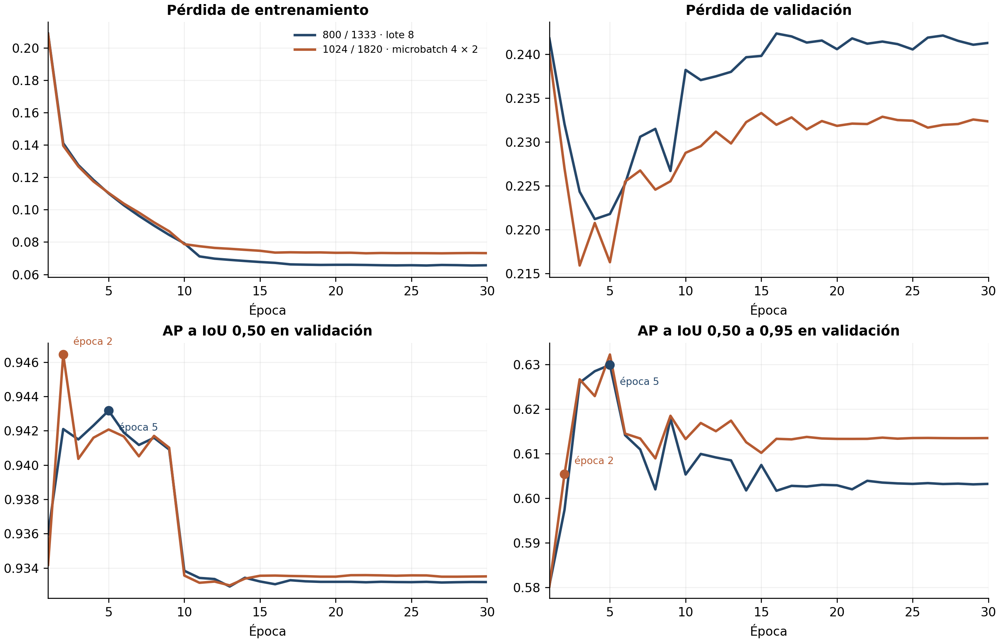
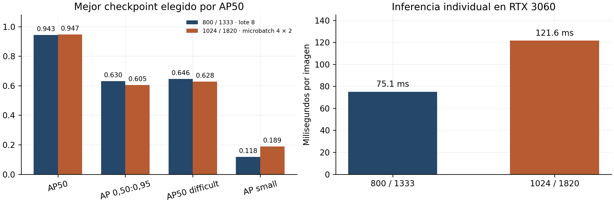
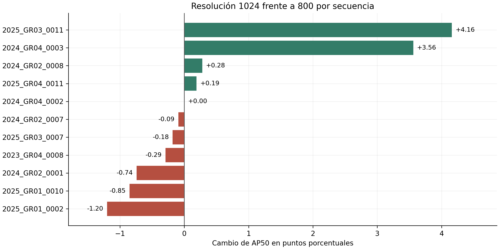
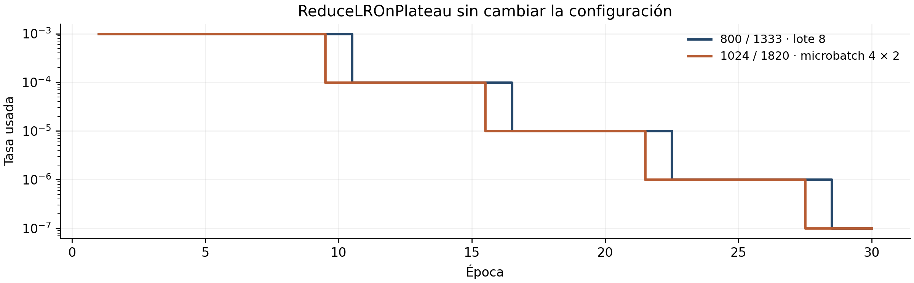

# Resolución 1024 frente a lr001 a resolución original

Validación de los checkpoints seleccionados por AP50. Misma semilla 0, COCO,
lr inicial 0,001, SGD, ReduceLROnPlateau y aumento base. No se usa test.
La resolución cambia de 800/1333 a 1024/1820. Para memoria, el lote físico 8
se sustituye por microbatch 4 y acumulación 2 (efectivo 8); no son numéricamente
idénticos. Ejecución terminada el 16/10/2026 hacia las 08:45 Europe/Madrid, salida 0.

| Métrica | lr001 800 | lr001 1024 | Cambio |
|---|---:|---:|---:|
| AP50 | 0,9433 | 0,9465 | +0,32 pp |
| AP 0,50:0,95 | 0,6302 | 0,6047 | −2,55 pp |
| AP75 | 0,7460 | 0,6990 | −4,70 pp |
| AP50 difficult | 0,6462 | 0,6282 | −1,80 pp |
| AP small | 0,1182 | 0,1886 | +7,04 pp |
| AP large | 0,6919 | 0,6459 | −4,60 pp |
| TP / FN a confianza 0,5 e IoU 0,5 | 1478 / 83 | 1493 / 68 | 15 FN menos |
| FN difficult | 65 | 56 | 9 menos |
| FP frente a etiquetas | 190 | 324 | 134 más |
| Precisión / F1 a confianza 0,5 | 0,8861 / 0,9155 | 0,8217 / 0,8840 | Empeoran |
| Recall difficult a confianza 0,5 | 0,7451 | 0,7804 | +3,53 pp |
| Inferencia individual, ms/imagen | 75,1 | 121,6 | +61,9 % |

**Decisión provisional:** conservar lr001 a resolución original como referencia
por equilibrio entre AP, FP y coste. La resolución beneficia pequeños y recall al
umbral fijo, pero no mejora de forma uniforme. Una semilla no prueba estabilidad.

**Selección del checkpoint:** res1024 alcanza su mejor AP50 del historial en la
época 2 (0,946440), frente a la 5 de lr001 (0,943169). Su máximo AP 0,50:0,95 está
en la época 5 (0,632233), mientras la época 2 da 0,605390. Se mantiene el criterio
AP50 definido antes del entrenamiento. No se ha reevaluado otro checkpoint ni se
afirma que toda ejecución de mayor resolución empeore el ajuste de cajas.
El historial y la evaluación final proceden de procedimientos distintos.

**Curvas:** pérdida de validación mínima en época 3 (0,215909), final 0,232343;
AP50 final 0,933510. Indicios de sobreajuste y posterior estancamiento. Las tasas
usadas son 0,001 en 1–9, 0,0001 en 10–15, 1e−5 en 16–21, 1e−6 en 22–27 y 1e−7
en 28–30. Las bajadas no recuperan el máximo AP50. No se recomienda prolongarlo.

**Secuencias:** AP50 sube en 4, baja en 6 y empata en una. GR03_0011 de 2025 gana
4,16 pp y reduce FN 28→22. GR04_0011 de 2025 reduce FN 33→25 pero sube FP 28→58.
GR01_0002 de 2025 pierde 1,20 pp. GR04_0003 de 2024 sigue perdiendo sus 6 difficult.

**Límites:** `PIDS2024_GR02_0001/frame_0444.jpg` contiene cuatro robots visibles,
pero su XML solo una caja. Algunas detecciones correctas cuentan como FP; no se
ha cuantificado la extensión ni se atribuyen todos los 324 FP a etiquetas omitidas.
GR02_0001 pasa de 49 a 71 FP frente a esas etiquetas. No se corrigen los conjuntos.
La latencia en lote (72,7→120,5 ms/imagen) usa lotes distintos, 8→4; se prefiere
la comparación individual. El pico de 8482 MiB fue del preflight, no del entrenamiento
completo. El mejor F1 muestreado pasa de confianza 0,85 a 0,95 (extremo de la rejilla).

## Figuras y regeneración

`python herramientas/comparar_resolucion.py` regenera CSV, JSON y PNG/PDF desde
los historiales y resúmenes ya evaluados, comprobando las mismas secuencias y
recuentos. No carga pesos ni ejecuta entrenamiento ni inferencia.
