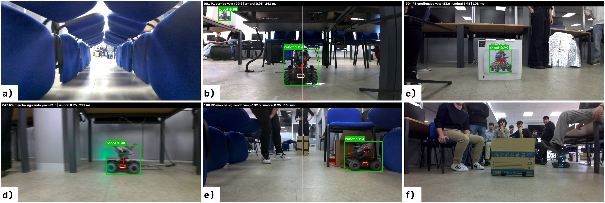
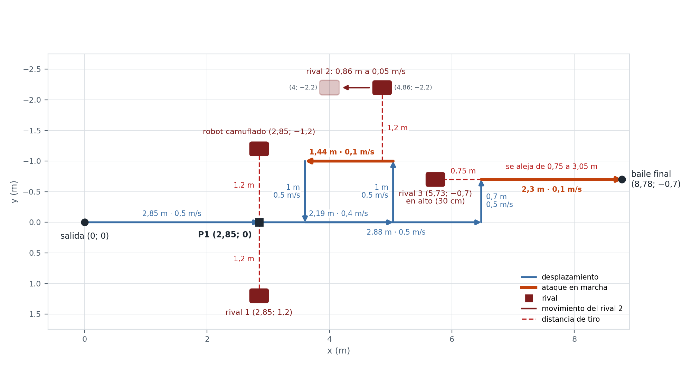

# RoboMaster Lock-On

**An autonomous DJI RoboMaster EP that drives a circuit, finds rival robots with its own detector and locks on with the gimbal to fire.**

We built the whole chain ourselves: the dataset, the object detector and the robot software. The detector was trained on our own 808 annotated frames, and in the live class demo the robot detected all four rival robots and fired on three of them.



<sub>Frames from the live demo on 12/11/2026, as seen by the robot's camera: tunnel, sweep at the first stop, a camouflaged robot printed on a box, a moving rival tracked while driving, the rival under the chairs, and the final dance.</sub>

**[Interactive results →](https://javiersaguar.github.io/RoboMaster-LockOn/)** · **[Full report (PDF, Spanish)](docs/entregas/PIDS_grupo2_entrega3.pdf)** · **[Demo code](ENTREGA%202/WEEK3/)**

## Highlights

| | |
|---|---|
| **Detector** | Faster R-CNN v2 · **AP@0.5 = 0.952** on the held-out test set (F1 0.939) |
| **Model selection** | 7 architectures, 13 training runs; rule fixed on validation *before* opening the test set |
| **Dataset** | 10 videos recorded from the robot · 808 frames · 1,420 robots annotated by 5 people (inter-annotator IoU 0.81) |
| **On the robot** | ~0.1 s per image on the laptop GPU (vs 2.3 s on CPU), 20 infrared shots per target |
| **Live demo** | 4 of 4 rivals detected, 3 of 4 hit, including one moving rival tracked while driving |

## How it works

```
 camera frame ──► Faster R-CNN v2 ──► filter by confidence and distance ──► aim gimbal ──► fire ×20
       ▲                                                                          │
       └────────────── chassis follows the planned route (odometry + IMU) ◄───────┘
```

1. **Drive.** The chassis follows a route measured on the circuit plan. Each leg runs in closed loop: wheel odometry stops it within 1 cm, and the IMU corrects heading drift.
2. **Sweep.** At each stop the gimbal sweeps left and right, and every frame goes through the detector.
3. **Select.** Detections need a high confidence (0.95, set on validation). The distance to each robot is estimated from the box height with a pinhole camera model, so robots that are too far away or off the circuit are ignored.
4. **Lock on and fire.** The gimbal turns towards the target, re-checks the aim on a fresh frame and fires a burst of 20 shots. A moving rival is tracked frame by frame, with its speed compensated, and the robot fires only when it is centred.
5. **Remember.** Attacked robots are stored in circuit coordinates, so the robot never shoots the same rival twice from another stop.



## What went wrong, and why

In the live demo, rival 3 was not hit, even though the detector saw it with confidence 1.00. With the turret turned 180°, the first frame above the threshold showed another robot in the background, under a chair, and the robot locked onto it. When rival 3 came into view, it was more than 25° away from the locked target, so the tracker treated it as a different robot and ignored it. The 20 shots went past it.

The cause was the strategy, not the detector. The distance filter that discards far robots ran at the first stop but not during attacks while driving, and applying it there would have skipped the background robot. In both attempts, the robot never fired at anything that was not a robot.

The report covers the full analysis, along with a one-by-one review of the 94 false positives on the test set: 59 of them turned out to be real robots that nobody had annotated.

## The three stages

| Stage | What we did | Where |
|---|---|---|
| **1 · Data** | Recording, frame extraction, shared annotation guidelines, EDA, cleaning (808 → 796) and augmentation with Albumentations (796 → 3,184) | [`ENTREGA 1/WEEK1/`](ENTREGA%201/WEEK1/) |
| **2 · Model** | Faster R-CNN v1/v2/v3, RetinaNet v1/v2 and SSD v1/v2 trained on JupyterHub. Learning rate and resolution studies, per-sequence error analysis | [`ENTREGA 1/WEEK2/`](ENTREGA%201/WEEK2/) |
| **3 · Robot** | Route planning, gimbal sweep, aiming, tracking, the circuit memory, LEDs and sound. Tested against a simulated robot before going to the lab | [`ENTREGA 2/WEEK3/`](ENTREGA%202/WEEK3/) |

## Tech stack

Python · PyTorch / torchvision · Albumentations · OpenCV · RoboMaster SDK · JupyterHub (lab GPUs) · Plotly (results site) · React + Framer Motion (presentation)

## Repository layout

| Path | Contents |
|---|---|
| `ENTREGA 1/WEEK1/` | Videos, annotation batches, EDA and augmentation notebooks |
| `ENTREGA 1/WEEK2/` | Training and evaluation notebooks, the training chain, metrics and figures |
| `ENTREGA 2/WEEK3/` | Robot demo: `demo.py`, `circuito.py` (route and settings), simulator and tests |
| `herramientas/` | Scripts for data preparation, annotation checks, figures and reports |
| `docs/` | Annotation guidelines, model selection, reports and the study guide |
| `web/` | GitHub Pages site with interactive results |
| `presentacion/` | Animated presentation (React + Vite) |

## Team

Built for *Proyectos en Ingeniería de Datos y Sistemas* (PIDS), Universidad Politécnica de Madrid, 2026.

| Member | Branch |
|---|---|
| Javier Saguar | `javier-saguar` |
| Alejandro Cuevas | `alejandro-cuevas` |
| Mónica Fernández | `monica-fernandez` |
| Pedro José Orrego | `pedro-orrego` |
| Daniel Naval | `daniel-naval` |

The detailed documentation is in Spanish. The project log is in [`ESTADO.md`](ESTADO.md) and the repository rules in [`AGENTS.md`](AGENTS.md).
