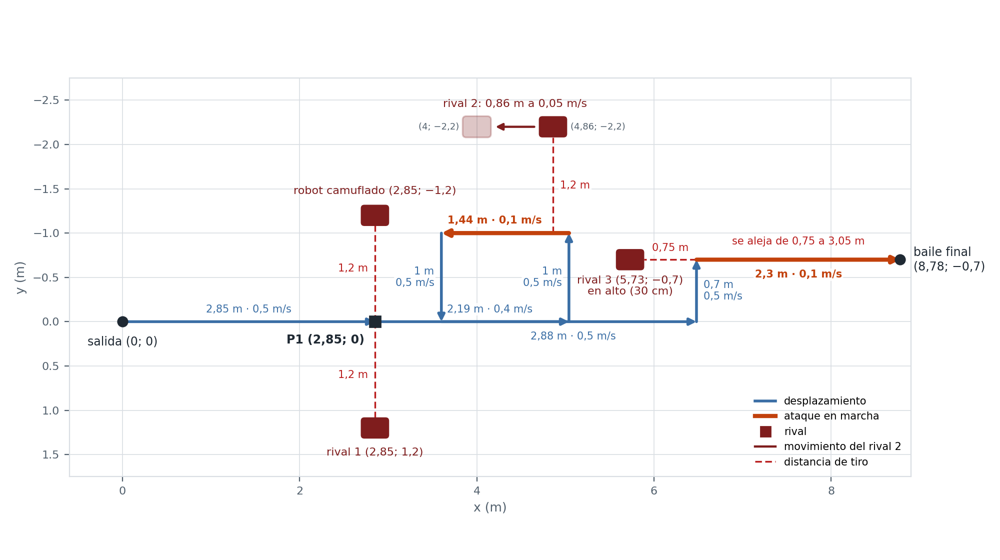
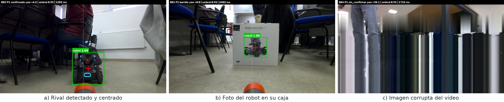
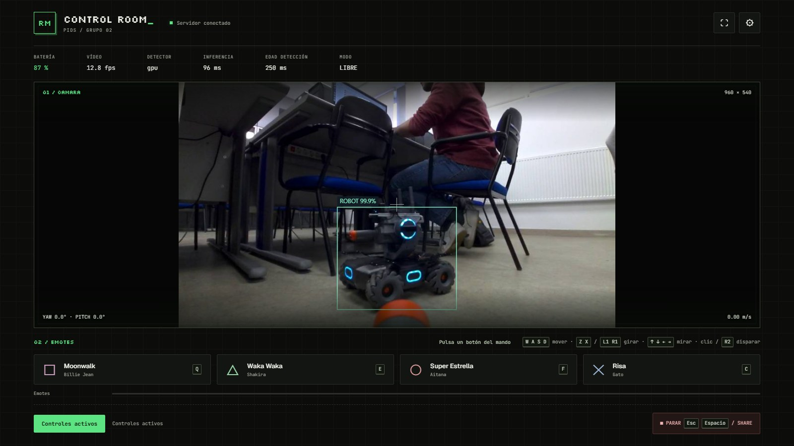
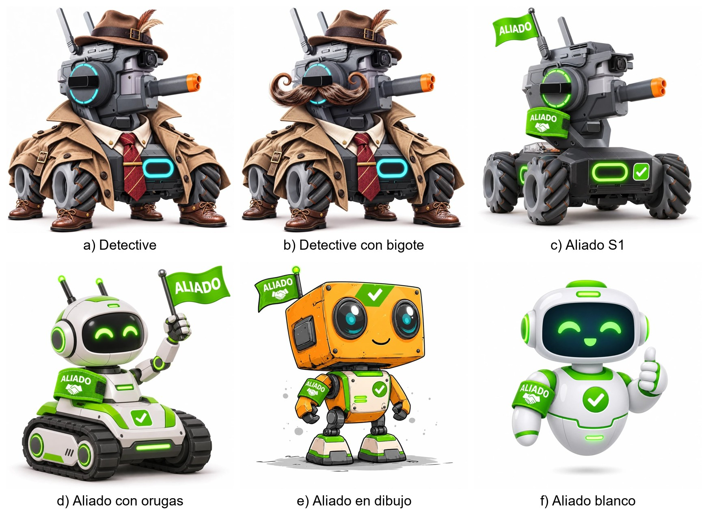
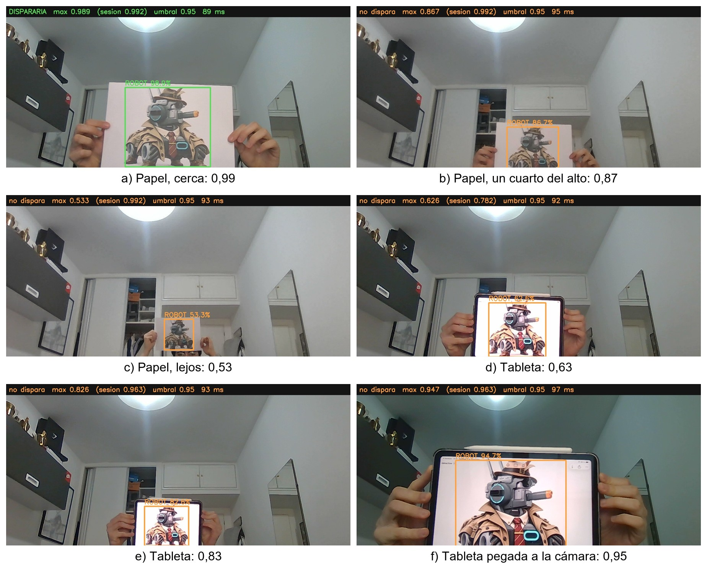

> **Borrador del Bloque 3** para la memoria de la entrega 3 (T23), empezado el 06/11/2026.
> Es la fuente del texto: `herramientas/generar_entrega3.py` lo añade, con el formato de la
> plantilla, a una copia de la memoria de la entrega 2 (`docs/informes/informe_entrega3.docx`).
> Lo marcado como [PENDIENTE] falta por medir en el laboratorio o por decidir. Las líneas que
> empiezan por `>` no pasan a la memoria. El texto evita nombres de variables y funciones,
> como pidió la revisión de la entrega 1.

# 13. Integración del detector en el robot

El Bloque 3 lleva el detector del Bloque 2 al RoboMaster EP, y añade un circuito en el que busca a los robots rivales con la cámara de la torreta, apunta y les dispara con el emisor de infrarrojos. El modelo es el elegido en el apartado 11.6: Faster R-CNN v2 con tasa de aprendizaje 10^−3^ y umbral de confianza 0,95.

El programa se ejecuta en un portátil unido al robot por wifi, con el SDK oficial [28], que solo funciona con Python 3.8. El PyTorch de esa versión no admite la RTX 5070 del portátil, así que la demo analiza las imágenes en CPU: entre 2,2 y 2,4 s por imagen. Esa latencia condiciona todo el bloque: el robot no puede mirar y moverse a la vez, y hay que repartir el tiempo entre girar, mirar y disparar. La configuración del circuito está separada del programa, y un robot simulado permite ejecutar la demo completa sin el RoboMaster, con imágenes del conjunto de test.

Para reducir la latencia se ha hecho una segunda versión de la demo que analiza las imágenes en la GPU. Un proceso aparte, con Python 3.11 y PyTorch con CUDA 12.8, carga el mismo modelo y recibe cada imagen del programa del robot. Esa versión de PyTorch admite la RTX 5070 del portátil y la RTX 3060 de los ordenadores del laboratorio, así que la demo puede hacerse con cualquiera de los dos. Con el robot simulado, cada imagen pasa de 1,3 s a 0,12 s, con las mismas detecciones. Si la GPU falla, esa imagen se analiza en CPU sin parar la demo, y la versión original se conserva por si la nueva da problemas.

# 14. El circuito

El recorrido se define sobre un plano en metros, con el origen en la salida de nuestro robot. Cada tramo es un desplazamiento del chasis sin girarlo, ya que las ruedas mecanum permiten moverse hacia los lados y hacia atrás. Todos los tramos se midieron en el laboratorio. La Figura B3.1 muestra el recorrido y la Tabla B3.1, cada movimiento.

| Tramo | Movimiento | Velocidad | Tiempo | Acción |
|---|---|---|---|---|
| P1 | 2,85 m adelante | 0,5 m/s | unos 6 s (medido) | Suena un coche de Fórmula 1 ajustado a la recta |
| P1 | Parada | — | — | Torreta a la derecha (90º): rival 1. Torreta a la izquierda (−90º): robot camuflado |
| R1 | 2,19 m adelante | 0,4 m/s | unos 6 s | — |
| R1 | 1 m a la izquierda | 0,5 m/s | unos 2,5 s | — |
| R1 | 1,44 m atrás | 0,1 m/s | unos 14,5 s | Torreta a la izquierda: rival 2, que avanza 0,86 m en paralelo a 0,05 m/s, sin parar |
| R1 | 1 m a la derecha | 0,5 m/s | unos 2,5 s | — |
| R2 | 2,88 m adelante | 0,5 m/s | unos 6 s | — |
| R2 | 0,7 m a la izquierda | 0,5 m/s | unos 2 s | — |
| R2 | 2,3 m adelante | 0,1 m/s | unos 23 s | Torreta hacia atrás (180º): rival 3, escondido, sin parar |
| Final | Baile | — | lo que dure la canción | Música, torreta y chasis bailando y LED de colores |

*Tabla B3.1. Movimientos del circuito, medidos en el laboratorio. Tras el túnel, los tramos a lo largo son un 15 % más largos que en el primer plano, que dejaba el final justo de espacio. Los tiempos incluyen la frenada al final de cada tramo.*

# 15. Detección, puntería y disparo

En cada parada, la torreta gira a los ángulos previstos y analiza una imagen en cada uno. Con el ángulo de la torreta y la distancia entre la caja detectada y el centro de la imagen se calcula cuánto girar, en horizontal y en vertical.

## 15.1. Puntería por pasos

En el laboratorio el robot detectaba al rival con confianzas de 0,96 a 1,00, pero no llegaba a disparar: la torreta daba saltos y las imágenes de confirmación salían sin detecciones o con franjas verticales. El SDK guarda el vídeo en una cola de 64 imágenes que nadie lee mientras el modelo analiza o la torreta gira; al llenarse, las imágenes llegan antiguas o dañadas (Figura B3.2). Ahora un hilo lee el vídeo todo el tiempo y guarda solo la última imagen, y cada análisis espera a una imagen tomada con la torreta ya quieta.

Con cada imagen la torreta corrige lo que falta para centrar al rival, hasta cuatro veces, y dispara cuando el error es menor de 3° o del 30 % del ancho de la caja. Los giros grandes se dividen en tramos de 45° como máximo, porque el SDK solo garantiza unos 55° por orden.

## 15.2. Ataque en marcha

En dos tramos el robot dispara sin detenerse. Tres tareas se ejecutan a la vez: el chasis mantiene su velocidad, la torreta busca y sigue al rival, y una tercera lanza el aviso de voz y la ráfaga. Así el chasis no espera a la inferencia: sus órdenes caducan a los 0,5 s y cada imagen tarda unos 2 s. La velocidad del retroceso sale de sumar los tiempos: girar la torreta 90° (3 s), ver al rival (2 a 4 s), el aviso (1,4 s) y la ráfaga (6,2 s). A 0,1 m/s, los 1,44 m duran unos 14,5 s, suficiente para todo ello. Durante la ráfaga, la torreta sigue al rival con su velocidad angular estimada más una corrección limitada al 80 % del error, porque sigue girando mientras se analiza la imagen siguiente.

En R1 el blanco también se mueve: el rival 2, 1,2 m a la izquierda, recorre 0,86 m a 0,05 m/s en el mismo sentido que nuestro robot. Lo mueve un compañero desde otro portátil, y la demo le avisa por la red del laboratorio al empezar el tramo. Para seguirlo se analiza la imagen más nítida de los últimos 0,2 s (varianza del laplaciano), con el ángulo que tenía la torreta al tomarla; se prevé su desplazamiento en la imagen, unos 2,4 °/s, desde la primera detección; y, cuando nuestro robot se para, se descuenta de esa velocidad la parte que venía de nuestro movimiento.

El rival 3 está detrás de nuestro robot, escondido. Por si está en alto, se busca con la torreta inclinada 10° y se corrige con la caja detectada: un robot 30 cm más alto que el cañón queda a unos 17° a 1 m y a 9° a 2 m, dentro de los 30° que admite la torreta.

## 15.3. Disparo, sonido y luces

Cada ráfaga son 20 disparos de infrarrojos, uno cada 0,3 s. El enunciado pide 12 impactos, y los 8 de más cubren los que el rival no registre. El sonido de la SCAR apenas se oía: el clip dura 0,19 s, el altavoz corta el principio de cada audio y el SDK lo subía por FTP en cada disparo. Se subió el volumen unos 9 dB, se añadieron 0,3 s de silencio al principio y la ráfaga pasó a ser una sola pista de 6,2 s, con cada disparo lanzado en su instante para que suene a la vez.

Al detectar un rival suena un aviso de voz de 1,4 s y la ráfaga espera a que termine. En la primera recta suena un Fórmula 1 ajustado a sus 6,4 s, y al final el robot baila con Super Estrella. Los LED indican el estado: ámbar buscando, rojo parpadeando al disparar y verde tras eliminar a un rival.

# 16. Robot camuflado y robots aliados

La primera idea era un señuelo: algo con aspecto de robot al que nuestro RoboMaster no disparase, para enseñar que no ataca a todo lo que ve. Se probaron dos variantes, generadas con una IA de imágenes (Anexo F, Figura F.1): un RoboMaster disfrazado de detective, que el detector no debía reconocer, y cuatro robots aliados marcados en verde, a los que no debía disparar. Las pruebas dieron lo contrario, porque el detector los reconoce a todos como robots, y la idea se transformó: el disfrazado pasó a ser un objetivo más, el robot camuflado que la demo elimina en P1, y la identificación de aliados quedó como trabajo futuro, con una marca de color en lugar de una forma. Las imágenes se pasaron por el detector tal cual y dentro de un fotograma de la cámara, a distintos tamaños (Tabla B3.2).

| Imagen | Confianza máxima | Veces que dispararía (de 5) | Verde dentro de la caja |
|---|---|---|---|
| RoboMaster disfrazado de detective | 98,8 a 99,9 % | 5 | 0,0 % |
| Aliado: RoboMaster S1 con bandera verde | 99,8 a 99,9 % | 5 | 5,7 % |
| Aliado: robot con orugas y cabeza redonda | 99,8 a 99,9 % | 5 | 11,0 % |
| Aliado: robot en dibujo | 92,7 a 97,9 % | 3 | 7,6 % |
| Aliado: robot blanco | 95,4 a 98,9 % | 5 | 12,5 % |

*Tabla B3.2. Respuesta del detector a imágenes de robots que no son RoboMasters reales.*

El disfraz no engaña al detector, y tampoco una forma de robot distinta. Tapando partes del detective, la confianza apenas baja si se tapa una sola (ruedas, cañón o chasis); solo baja al 52 % si se tapan todas a la vez. El modelo ha aprendido el concepto de robot a partir del conjunto, no por una pieza concreta. En cambio, un círculo, una caja o una caja con ruedas dibujados no dan ninguna detección. La demo aprovecha este resultado: en P1, el robot elimina al rival de la derecha y después al robot camuflado de la izquierda.

Para no disparar a un aliado hace falta una marca, no una forma. Los aliados tienen entre un 5,7 y un 12,5 % de verde intenso dentro de su caja y el detective un 0 %, así que una regla de «más de un 2 % de verde: aliado» los separa con margen. Es como en las competiciones de RoboMaster, donde los equipos se distinguen por el color de las luces. Se ha dejado como trabajo futuro, porque la luz del laboratorio y un fondo verde detrás de un enemigo podrían confundirla. El estudio completo está en el repositorio [21].

## 16.1. Prueba con el robot camuflado impreso

El robot camuflado se imprimió en papel para colocarlo en P1. Antes de llevarlo al laboratorio se comprobó con la webcam de un portátil y el mismo modelo de la demo: 20 imágenes, una por segundo, moviendo la hoja a distintas distancias. Se repitió con la misma imagen en la pantalla de una tableta (Tabla B3.3 y Anexo F, Figura F.2).

| Soporte | Tamaño del robot en la imagen | Confianza máxima | ¿Dispararía? |
|---|---|---|---|
| Papel | De un tercio a la mitad del alto | 0,96 a 0,99 | Sí |
| Papel | Un cuarto del alto | 0,87 a 0,92 | No |
| Papel | Lejos | 0,53 | No |
| Tableta | De un tercio a la mitad del alto | 0,29 a 0,63 | No |
| Tableta | Casi toda la imagen | 0,55 a 0,95 | Solo pegada a la cámara |

*Tabla B3.3. Robot camuflado impreso y en pantalla delante de la webcam del portátil, con el detector de la demo.*

En papel, el detector reconoce al robot cuando ocupa una parte considerable de la imagen, y no dio falsos positivos sobre el fondo, donde la confianza máxima fue de 0,32. Con la pantalla los resultados empeoran mucho: su brillo hace que la cámara reduzca la exposición y oscurezca el resto de la escena, y los reflejos y el marco dificultan ver el contorno del robot. Por eso en la demo se usará impreso en papel mate A3, que evita esos problemas y permite que el robot se vea con tamaño suficiente desde P1.

Con la cámara del robot desde P1 dio de 0,72 a 0,97, casi siempre por debajo de 0,95, así que hacia ese lado basta un umbral de 0,7 si la caja no ocupa más de media imagen.

# 17. Control manual del robot

Además del circuito, se ha hecho una interfaz web para manejar el robot desde el portátil, con teclado y ratón o con un mando de PS4: sirve para colocarlo, probar la cámara y el detector y hacer una demostración libre (Figura B3.3). Muestra el vídeo con las detecciones y permite mover el chasis y la torreta, disparar y lanzar bailes, con los mismos topes de velocidad que la demo. Si dejan de llegar órdenes durante 0,3 s, el robot se para. El detector va en el mismo proceso aparte con la GPU que la segunda versión de la demo (apartado 13), entre 32 y 94 ms por imagen, lo que permite un disparo automático opcional. Tiene 42 pruebas automáticas.

El 11/11 se probó con el robot real en el suelo del laboratorio, manejándolo con el mando de PS4 (Figura B3.4). El vídeo llegó a la interfaz a entre 8 y 16 imágenes por segundo y el detector marcó a los robots con confianzas de 0,97 a 1,00, también con varios a la vez y detrás de obstáculos. Los bailes se lanzan desde el mando y se avisan en pantalla.

[PENDIENTE: medir el retardo del vídeo.]

# 18. Pruebas y estado

Cada ejecución guarda las imágenes analizadas, con sus detecciones, tiempos y disparos, y una foto de la cámara cada 0,5 s. Las pruebas en el laboratorio del 4 al 11 de noviembre (Anexo G) sirvieron para corregir la cola de vídeo (apartado 15.1), alargar un 15 % los tramos tras el túnel y descartar sillas cercanas y robots del fondo por el alto de la caja y la distancia.

La demo oficial se hizo en clase el 12/11, con el detector en la GPU (Figura B3.5). El robot cruzó el túnel de sillas, se paró en P1 y disparó 20 veces al rival 1 (confianza 1,00) y otras 20 al robot camuflado (0,99). En R1 disparó otras 20 al rival 2 mientras los dos se movían (1,00) y, en el último tramo, con la torreta girada 180º, 20 más al rival 3, escondido en una caja (1,00). Los rivales registraron los 80 disparos. La detección pequeña de b), a unos 3 m y fuera del circuito, se descarta por la distancia.

Después, el profesor preparó un intento sorpresa con imágenes propias, robots tapados y un robot distinto (Figura B3.6). En P1 puso un robot tapado con una tela (0,85 a 0,91) y la foto de un robot entre humo (0,59); la demo no disparó a ninguno, porque quedaron por debajo del umbral. En la recta final colocó un robot con partes rojas, de un modelo que no está en nuestros datos: lo detectó con 0,96 a 0,99 y le disparó, igual que al rival 2 (1,00). El detector generaliza a otros robots, pero un robot tapado o una imagen borrosa no alcanzan el umbral de 0,95, elegido para evitar falsos positivos.

[PENDIENTE: numeración final de tablas y figuras e índice.]

# 19. Conclusiones

**Datos.** El aumento de datos ha sido la mejora más importante, especialmente para los robots difficult. Su anotación también en validación y test ha permitido identificar los principales fallos del detector.

**Modelo.** La arquitectura tiene más impacto que los ajustes de entrenamiento. Faster R-CNN v2 es el modelo final, con un AP@0,5 de 0,95 en test. Sin embargo, sigue teniendo dificultades con los objetivos más complejos y todos los modelos presentan sobreajuste temprano.

**Robot.** La latencia del detector condiciona el funcionamiento: el robot debe repartir el tiempo entre movimiento, detección y disparo, utilizando imágenes recientes y nítidas. Además, el modelo reconoce qué es un robot, pero no distingue aliados de rivales, por lo que necesita una marca adicional para diferenciarlos. En la demo en clase eliminó a los cuatro rivales y detectó un robot distinto a los del entrenamiento, aunque no uno tapado con una tela.

# Anexo F. Robot camuflado y robots aliados

Imágenes del estudio del apartado 16. La Figura F.1 reúne los robots generados con IA. La Figura F.2 muestra capturas de la webcam del portátil con el detector de la demo: en verde, la caja que supera el umbral de 0,95 y con la que la demo dispararía; en naranja, las que no lo superan.

# Anexo G. Desarrollo del circuito

Pruebas del circuito completo en el laboratorio el 11/11, la víspera de la demo en clase. La Figura G.1 muestra la imagen analizada al encontrar cada objetivo, con los rivales de entonces: la foto de la caja de un RoboMaster como rival 1 y el robot camuflado impreso sobre otra caja.

