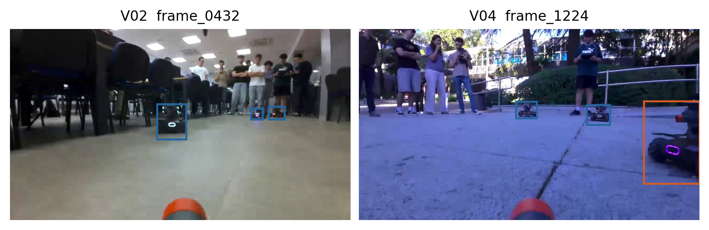
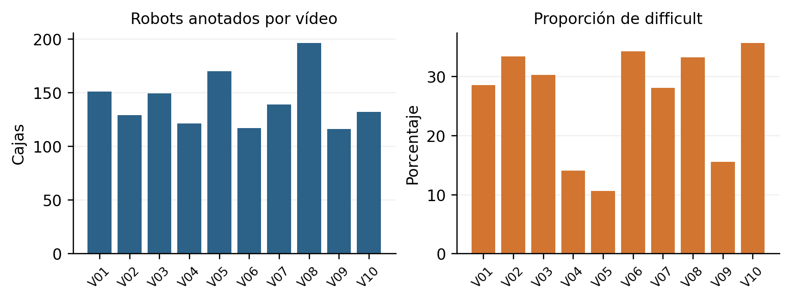
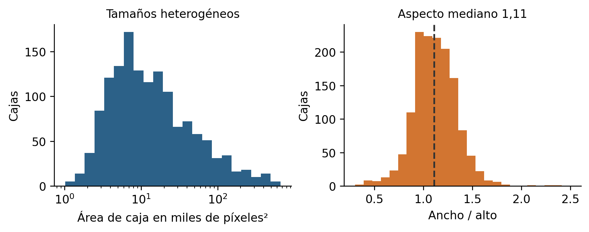
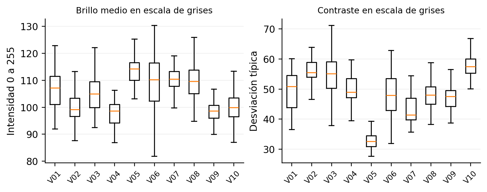
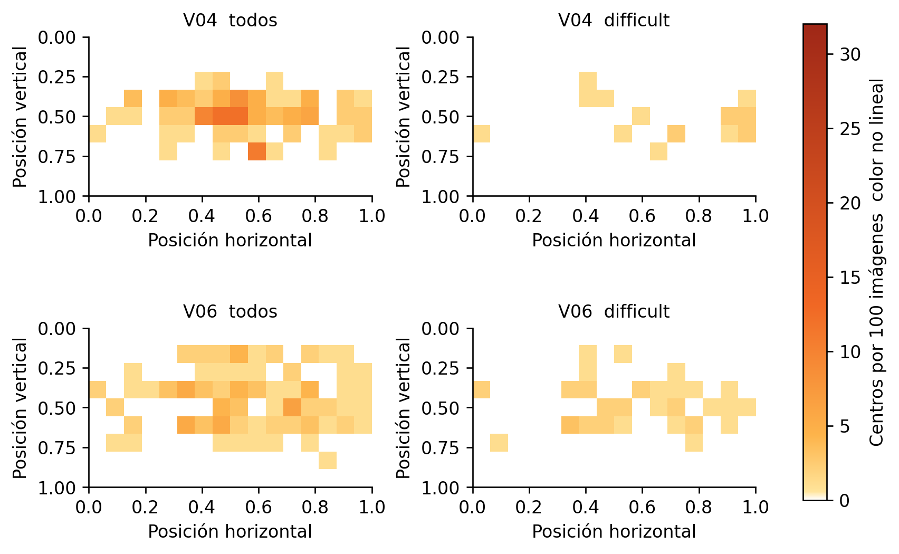
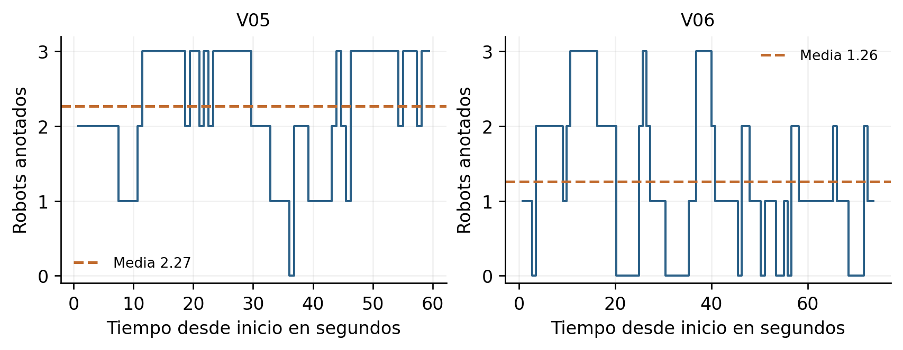
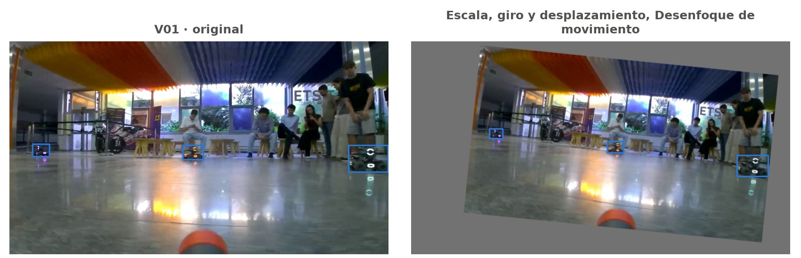
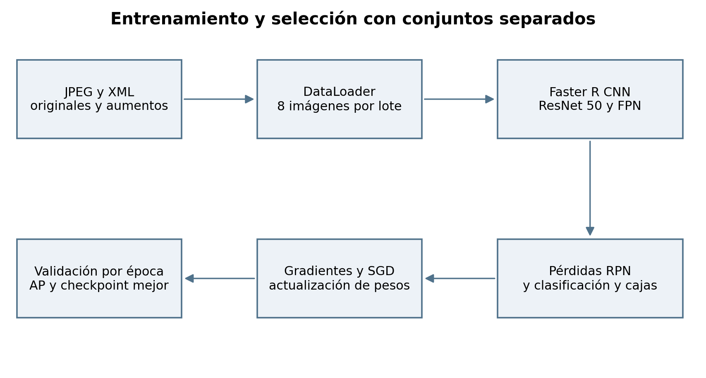
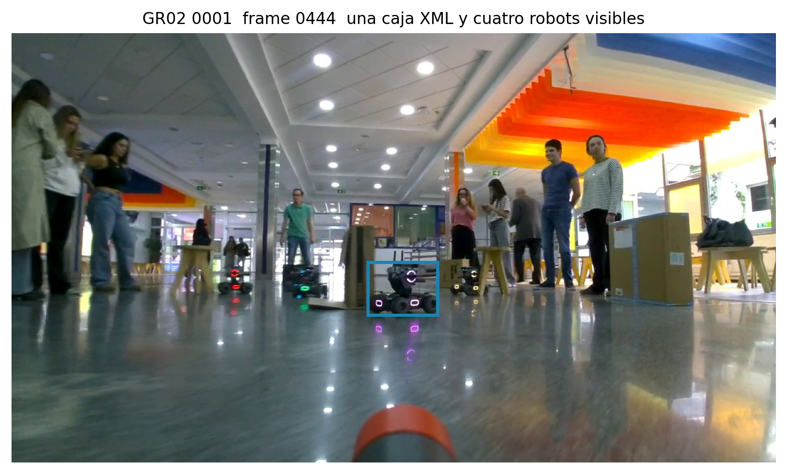
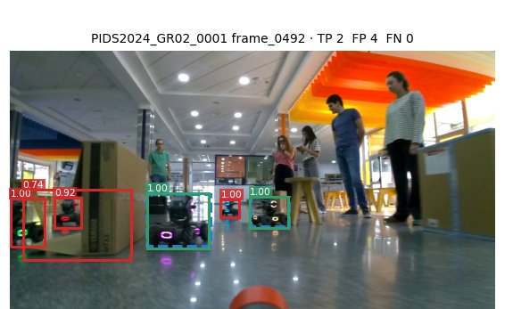

# Memoria del proyecto Fases 1 y 2

Autores: Javier Saguar, Alejandro Cuevas, Mónica Fernández, Pedro José Orrego, Daniel Naval

Contenido actualizado el 15 de octubre de 2026. Grupo 2 según el usuario pids2; confirmar identificación administrativa y fecha de entrega.

## Respuesta a la revisión anterior

No aplica a la primera entrega. No hay comentarios docentes incorporados en esta versión de trabajo.

## Reparto del trabajo

Distribución documentada en los commits y tareas. La participación final se revisará en grupo antes de entregar.

| Integrante | Datos y análisis | Entrenamiento y evaluación |
| --- | --- | --- |
| Javier Saguar | Organización, extracción, lote A, revisión, depuración, aumento y ampliaciones del EDA | Experimentos en laboratorio, evaluación y memoria |
| Alejandro Cuevas | Lote B, revisión de C y EDA | Adaptación de train/test y propuestas de mejora |
| Mónica Fernández | Lote C y calibración | Pendiente de consolidar reparto |
| Pedro José Orrego | Lote D, calibración y selección de figuras | Pendiente de consolidar reparto |
| Daniel Naval | Lote E y calibración | Pendiente de consolidar reparto |

Tabla 1. Reparto provisional del trabajo documentado.

## Índice

## 1. Introducción

### 1.1. Contexto y motivación

El proyecto desarrolla un detector de RoboMasters rivales desde la cámara de un robot móvil. Movimiento, cambios de tamaño, iluminación y oclusión dificultan localizar sus cajas. La percepción alimentará una futura estrategia de apuntado y actuación.

### 1.2. Objetivos del proyecto

El Bloque 1 construye y caracteriza datos; el Bloque 2 ajusta el detector y el Bloque 3 lo integrará con el robot. Se obtienen 808 originales anotados y se seleccionan 796 tras revisar sus etiquetas.

## 2. Recolección de datos

### 2.1. Estrategia y condiciones de captura

Se grabaron diez vídeos en seis tipos de escenario, variando luz, contraluces, reflejos, obstáculos y distancias. Se incluyeron movimiento y patas de sillas porque se prevén en la demo. Los dos exteriores comparten ubicación; aún falta el circuito definitivo.

### 2.2. Extracción de imágenes

La cámara entrega 1280 × 720 a unos 30,30 fps. INTERVAL=24 conserva una muestra cada 0,79 s. La suma por vídeo floor(frames/24) produce 808 imágenes a partir de 19 508 frames y 643,8 s; no se redondea la duración global. Se reduce redundancia sin multiplicar el coste de anotación.

| Vídeo | Escenario | Duración s | Frames | Imágenes |
| --- | --- | --- | --- | --- |
| V01 | Vestíbulo granito | 65,4 | 1982 | 82 |
| V02 | Aula con sillas | 59,9 | 1815 | 75 |
| V03 | Aula blanca | 60,2 | 1823 | 75 |
| V04 | Exterior | 66,1 | 2003 | 83 |
| V05 | Pasillo | 59,6 | 1807 | 75 |
| V06 | Vestíbulo de color | 74,1 | 2244 | 93 |
| V07 | Vestíbulo granito | 61,2 | 1855 | 77 |
| V08 | Vestíbulo de color | 81,2 | 2460 | 102 |
| V09 | Exterior | 56,2 | 1704 | 71 |
| V10 | Aula con sillas | 59,9 | 1815 | 75 |
| Total | 1280 × 720 a 30,30 fps | 643,8 | 19 508 | 808 |

Tabla 2. Grabaciones propias y número exacto de imágenes extraídas.

## 3. Anotación de datos

Se utilizó labelImg [1] y XML PascalVOC, con una única clase robot. Cada integrante anotó su lote y otro revisó las cajas. Se conservaron imágenes negativas con XML vacío para que el entrenamiento no las ignore.

| Caso | Criterio operativo |
| --- | --- |
| Robot rival | Incluir chasis, ruedas, gimbal y cañón; excluir antenas. |
| Elementos ajenos | No anotar el cañón propio, reflejos ni robots en pantallas. |
| Oclusión y borde | Anotar si es reconocible y se ve al menos un 30 %; caja sobre la parte visible. |
| Difficult | Marcar si tiene menos de 30 px de ancho, menos de la mitad visible o está muy movido. |
| Robot muy pequeño | No anotar por debajo de 10 px de lado; conservar criterios en el aumento. |
| Negativo | Guardar imagen y XML sin objetos. |

Tabla 3. Criterios comunes aplicados a los lotes.

Como se observa en la figura siguiente, el criterio distingue cajas normales y difficult sin crear una segunda clase. Una frontera superior distinta alteraría tamaños y centros, por lo que se excluyen antenas y se ajusta el resto del robot de manera consistente.

Figura 1. Anotaciones de interior y exterior. Azul: normal; naranja: difficult.

Los cinco anotadores etiquetaron las mismas 20 imágenes de calibración. El IoU medio entre parejas fue 0,81; el borde superior presenta la mayor discrepancia, 7 px de mediana frente a 4–5 px en los otros bordes. Esto identifica un criterio por discutir, pero no establece un techo matemático del AP del modelo. Falta cerrar en grupo la ronda de discusión de T01.

## 4. Análisis exploratorio de los datos

### 4.1. Inventario y equilibrio

El EDA se calcula sobre los 808 originales, antes de excluir imágenes. Los aumentos no se mezclan en estas estadísticas. Las cifras de la tabla y la figura permiten separar cantidad de imágenes, número de objetos y dificultad.

| Estadística | Valor |
| --- | --- |
| Secuencias / imágenes | 10 / 808 |
| Imágenes medias por secuencia | 80,8 |
| Cajas / cajas medias por imagen | 1420 / 1,76 |
| Difficult | 375 cajas · 26,4 % |
| Imágenes negativas | 41 · 5,07 % |
| Área media de caja | 33,627 miles de píxeles² |
| Área mínima / máxima | 1,020 / 661,074 miles de píxeles² |
| Aspecto mediano ancho / alto | 1,11 |

Tabla 4. Estadísticas de los originales anotados.

Figura 2. Recuento y dificultad por vídeo; sus diferencias motivan analizar cada secuencia.

No basta con equilibrar imágenes: V05 contiene 170 robots y V06 solo 117. V06 tiene 22 negativos en 93 imágenes, mientras V08 no tiene negativos y concentra 65 difficult. Se conservan estas diferencias porque representan situaciones reales de captura.

### 4.2. Tamaño forma e iluminación

Figura 3. Área y forma de las cajas de los 1420 robots. El eje de área es logarítmico.

La distribución de la figura tiene una cola amplia de áreas, pero no hay cajas originales de menos de 30 px de ancho. La relación de aspecto mediana es 1,11. El análisis de cobertura de anclas obtiene un 99,6 % con IoU ≥0,5: no se cambia su configuración por ahora y se evita deformar las proporciones durante el aumento.

Figura 4. Brillo y contraste por secuencia, calculados en escala de grises.

Los canales RGB caracterizan el color dominante, no solo la iluminación: también dependen del suelo y las paredes. Por eso se complementan con media y desviación típica de intensidad, y con nitidez por varianza del Laplaciano. El tono azulado de exteriores justifica cambios de color suaves; no se confunde ese tono con falta de luz. Se identificaron 52 imágenes poco nítidas para revisión visual.

La miniatura más parecida a una imagen procede del mismo vídeo en el 74 % de los casos. Esa correlación aconseja separar grabaciones completas, evitando una validación artificialmente fácil con fotogramas vecinos.

### 4.3. Posición y evolución temporal

Figura 5. Selección de mapas por vídeo. Todos y difficult comparten escala; se cuentan centros por 100 imágenes, incluidos los negativos.

La figura compara la posición de las anotaciones en un exterior y un interior con muchos negativos. Se normalizan los centros por tamaño de imagen y el histograma 16 × 9 por número de imágenes. La paleta cálida con intensidad no lineal hace visibles frecuencias bajas, pero mantiene cero blanco y un máximo común. No representa el área cubierta por las cajas.

Figura 6. Recuento por fotograma anotado en V05 y V06; la línea discontinua es su media.

Las curvas muestran por qué la media de V05 es 2,27 y la de V06 1,26: el segundo vídeo contiene tramos sin objetivos. El complemento HTML incluye los diez vídeos y 132 ventanas disjuntas de 5 s para comparar todos frente a difficult. Son muestras cada 24 frames, no trayectorias individuales ni presencia inferida entre fotogramas.

## 5. Aumento de datos

Se aplica solo al entrenamiento y desde originales. Tres copias por imagen se combinan con las 796 originales depuradas: 3184 imágenes y 5566 cajas. Las 672 imágenes de validación y las 718 de test son secuencias independientes de otros grupos y no reciben aumento. Se mantiene un manifiesto de semillas y transformaciones [2].

| Técnica | Probabilidad | Variabilidad simulada |
| --- | --- | --- |
| Volteo horizontal | 0,50 | Orientaciones válidas de robots; no se invierte el suelo. |
| Afín sin deformación | 0,70 | Escala ×0,6–1,25; giro ±6°; desplazamiento horizontal ±8 % y vertical ±5 %. |
| Brillo y contraste o gamma | 0,50 conjunta | Exposición y sombras de intensidad global. |
| Tono y saturación o RGB | 0,30 conjunta | Balance de blancos y cambios suaves de color. |
| MotionBlur 3–9 px | 0,15 | Movimiento de cámara y objetivos. |
| JPEG o ruido o resolución | 0,30 conjunta | Una degradación entre JPEG, ruido gaussiano, ISO o resolución ×0,5–0,75. |
| Oclusión de barras | 0,15 | Obstáculos finos; cada barra limita la anchura tapada de cada robot. |

Tabla 5. Configuración del aumento base. Las alternativas OneOf no se aplican todas a la vez.

Figura 7. Original y una copia del aumento base, con las cajas transformadas.

Se descartan volteo vertical y giros de 90°, el recorte 4:3 redimensionado a 16:9 que ensancha robots y la perspectiva con cajas incorrectas en Albumentations 1.4.18. El relleno gris evita duplicar robots sin etiqueta en los bordes. Se usan cajas ajustadas y filtros de lado mínimo 10 px y visibilidad 30 %.

## 6. Depuración de datos

Se revisaron visualmente 69 imágenes: 52 de baja nitidez, 11 casi duplicadas y 6 casos dudosos. Se excluyeron una imagen con un robot visible imposible de anotar de forma consistente y 11 redundantes. Se conservaron 41 imágenes movidas con sus robots difficult y los negativos difíciles. La baja nitidez no es por sí sola un motivo para borrar.

| Conjunto | Imágenes | Cajas |
| --- | --- | --- |
| Original anotado | 808 | 1420 |
| Original tras depuración | 796 | 1399 |
| Copias del aumento base | 2388 | 4167 |
| Entrenamiento total | 3184 | 5566 |

Tabla 6. Efecto de la depuración y del aumento base.

Las exclusiones están identificadas en docs/depuracion_excluir.csv; no se borra ningún original. Quedan cuatro imágenes por debajo del objetivo de unas 800. Se prioriza no entrenar con etiquetas contradictorias, y se mantiene prevista una captura complementaria si el grupo o el profesorado exige reponerlas.

Al aumentar se pierden 30 de las 4197 cajas que entrarían en las copias, un 0,715 %, frente al 14,1 % del aumentador de referencia de la asignatura. La relación de aspecto mediana permanece en 1,10 frente a 1,11 original. Es una comprobación de integridad del dataset, no una prueba de mejora del detector.

### 6.1. Ampliaciones preparadas y límites

Se han implementado perfiles optativos con sombras y llovizna solo en V04/V09, obstáculos con textura y oscuridad o movimiento adicionales en una copia de imágenes con difficult. La unión de máscaras de los obstáculos se limita al 25 % del área de cada caja, que no equivale al área visible del cuerpo del robot. El combinado se ha comprobado en memoria sobre 2388 copias, pero aún no se ha entrenado.

Estas ampliaciones tienen destinos separados y no sustituyen el aumento base de los experimentos ya medidos. La lluvia sintética no acredita robustez en lluvia real. Los límites principales del Bloque 1 son la variedad de exteriores, el desacuerdo sobre el borde superior y la falta de ejemplos del circuito definitivo.

## 7. El pipeline de entrenamiento

Se entrena sobre 3184 imágenes con aumento base o sobre las 796 originales. Validación contiene 672 imágenes de 11 secuencias externas, con 1561 robots, 255 difficult y ningún negativo. Test contiene 718 imágenes y se reserva para evaluar el modelo definitivo una sola vez; no hay resultados de test en este informe.

Figura 8. Flujo realmente usado para ajustar pesos y seleccionar el checkpoint con validación.

La imagen se carga en RGB, se pasa a tensor en [0,1] y el modelo normaliza y escala internamente. Un batch es el lote de 8 imágenes que produce una actualización; una época recorre todo el entrenamiento. El lote limita memoria y permite estimar gradientes sin cargar el conjunto completo en GPU. Se suman las pérdidas de RPN, clasificación y regresión; SGD actualiza los pesos mediante retropropagación.

Las cajas difficult también participan en el entrenamiento: sin_difficult elimina el flag del diccionario que se entrega al detector, no sus cajas. Para la pérdida de validación se usa no_grad; para las detecciones y AP, eval. Cada época se guarda model_last y solo se reemplaza model_best cuando sube AP@0,5.

## 8. Modelos

Se ha probado Faster R-CNN ResNet-50 con FPN [3,4], una red de dos etapas: el RPN propone regiones y la cabeza clasifica y ajusta sus cajas. Se inicializa con COCO y se sustituye la cabeza por fondo y robot. FPN combina escalas, relevante para objetivos a distancias diferentes. No se ha realizado todavía una comparación de arquitecturas.

El código contempla Faster R-CNN v2 y una variante MobileNet, entre otras. Los resultados de COCO no predicen la ganancia en nuestros datos. Cualquier comparación futura debe medir precisión y latencia para el uso en el robot.

## 9. Hiperparámetros

| Parámetro | Valor aplicado |
| --- | --- |
| Épocas / lote / semilla | 30 / 8 / 0 |
| Optimizador | SGD; momentum 0,9; weight decay 0,0005 |
| Tasa inicial | 0,0001 en originales; 0,001 en lr001 |
| Programador | ReduceLROnPlateau con pérdida de validación |
| Bajada / paciencia / mínimo | ×0,1 / 5 épocas / 1e−10 |
| Resolución del detector | min_size=800; max_size=1333 |
| Datos aumentados | Originales y 3 copias; sin aumento online |
| Checkpoint seleccionado | Mayor AP@0,5 en validación |
| Entorno | PyTorch 2.4.1; torchvision 0.19.1; RTX 3060 12 GB |

Tabla 7. Configuración común de los experimentos medidos.

La tasa 0,001 se ensayó como salto de diez veces manteniendo los otros parámetros. No se añadieron warmup, otra arquitectura ni los perfiles nuevos de aumento. Cambiar una variable facilita interpretar el resultado, aunque una sola semilla no mide su variabilidad.

## 10. Métricas

IoU es la intersección entre caja predicha y real dividida por su unión. Con IoU≥0,5 y confianza≥0,5 se emparejan detecciones por confianza: acierto TP, detección sin pareja FP y robot sin pareja FN. Precisión es TP/(TP+FP), exhaustividad TP/(TP+FN) y F1 la media armónica de ambas.

AP resume la curva precisión–exhaustividad al variar confianza. AP@0,5 fija IoU en 0,5; AP@0,75 exige cajas más ajustadas; AP 0,50:0,95 promedia umbrales de IoU de 0,50 a 0,95. Al haber una clase, la media entre clases coincide con su AP. En los grupos normales/difficult se ignoran las anotaciones y detecciones emparejadas del otro grupo.

AP small usa la categoría de área de COCO, no el criterio de ancho <30 px de nuestra anotación. El AP de grupos y el recall a confianza fija responden a preguntas distintas. Además, las etiquetas incompletas de validación pueden penalizar detecciones correctas como FP; no se interpreta el recuento como error visual confirmado.

## 11. Experimentos

### 11.1. Comparación del aumento y de la tasa

| Experimento | Mejor época | AP50 historial | AP50 evaluación | AP evaluación |
| --- | --- | --- | --- | --- |
| Sin aumento lr 0,0001 | 20 | 0,9229 | 0,9228 | 0,5809 |
| Aumento base lr 0,0001 | 29 | 0,9425 | 0,9416 | 0,6081 |
| Aumento base lr 0,001 | 5 | 0,9432 | 0,9433 | 0,6302 |

Tabla 8. Mejor checkpoint por AP50. AP sin sufijo es AP 0,50:0,95. El historial y la evaluación final se mantienen separados.

El aumento base mejora especialmente difficult: AP50 de 0,5518 a 0,6341. La comparación a igual número de épocas incluye cuatro veces más imágenes y actualizaciones con aumento; no permite atribuir toda la diferencia solo a las transformaciones. La ejecución con lr001 conserva ese mismo conjunto de 3184 imágenes.

Figura 9. Pérdidas y AP por época. Los puntos señalan los checkpoints elegidos por AP50.

Con lr001 se alcanza AP50=0,943169 en la época 5; la referencia llega a 0,942506 en la 29. Es aprendizaje más rápido y solo +0,066 puntos en el mejor AP50 del historial. La ejecución completa terminó el 15/10 a las 22:13, incluida la validación, con salida 0.

### 11.2. Curvas y resultado del cambio de tasa

La pérdida de validación mínima aparece en la época 4, 0,221198, y sube hasta 0,241296 en la 30 mientras la de entrenamiento baja a 0,065661. El AP50 final cae a 0,933178. Hay indicios de sobreajuste después del óptimo temprano: se conserva model_best de la época 5 y no model_last.

Figura 10. Tasa usada en cada época. Las bajadas de ReduceLROnPlateau no recuperan el óptimo temprano.

En lr001 se usa 0,001 en épocas 1–10, 0,0001 en 11–16, 0,00001 en 17–22, 0,000001 en 23–28 y 0,0000001 en 29–30. La tasa del experimento con aumento original no bajó. Más épocas con esta ejecución no solucionaron la pérdida de validación.

| Métrica en validación | lr 0,0001 | lr 0,001 | Cambio pp |
| --- | --- | --- | --- |
| AP50 todos | 0,9416 | 0,9433 | +0,17 |
| AP 0,50:0,95 todos | 0,6081 | 0,6302 | +2,21 |
| AP75 todos | 0,7146 | 0,7460 | +3,14 |
| AP50 normales | 0,9664 | 0,9740 | +0,76 |
| AP50 difficult | 0,6341 | 0,6462 | +1,21 |
| AP small | 0,1074 | 0,1182 | +1,08 |

Tabla 9. Evaluación final de los mejores checkpoints con el mismo procedimiento y conjunto.

La mejora principal está en localizar mejor las cajas. AP50 ya era alto y su incremento es pequeño. La ganancia en objetos pequeños es modesta y sigue siendo el principal punto débil; esto justifica estudiar una mayor resolución como siguiente experimento.

### 11.3. Errores umbral y coste de inferencia

| Confianza ≥0,5 e IoU ≥0,5 | lr 0,0001 | lr 0,001 |
| --- | --- | --- |
| TP / FN | 1478 / 83 | 1478 / 83 |
| FN normales / difficult | 20 / 63 | 18 / 65 |
| FP frente a las etiquetas | 210 | 190 |
| Precisión | 0,8756 | 0,8861 |
| Recall total | 0,9468 | 0,9468 |
| Recall difficult | 0,7529 | 0,7451 |
| F1 | 0,9098 | 0,9155 |

Tabla 10. Recuento a un umbral fijo; no debe confundirse con el AP.

El cambio reduce 20 FP y detecta dos normales adicionales, pero pierde dos difficult más; el TP total no cambia. Que AP difficult suba a 0,6462 mientras baja su recall a confianza 0,5 es compatible: el AP recorre confianzas y también depende de la ordenación y las cajas.

Figura 11. Precisión exhaustividad y F1 de lr001 en la rejilla de confianzas de validación.

El mejor F1 muestreado pasa de 0,95 a 0,85. Son muestras cada 0,05, no una estimación exacta del óptimo, y el modelo definitivo requerirá elegir su propio umbral según el coste de errores en la demo. Se midieron 72,7 ms por imagen en lote y 75,1 ms una a una; no incluyen captura, red ni actuación del robot.

### 11.4. Comparación por secuencia

| Secuencia | AP50 antes | AP50 lr001 | FN antes → después |
| --- | --- | --- | --- |
| 2023 GR04 0008 | 0,9876 | 0,9886 | 2 → 2 |
| 2024 GR02 0001 | 0,9393 | 0,9380 | 1 → 0 |
| 2024 GR02 0007 | 0,9877 | 0,9873 | 1 → 1 |
| 2024 GR02 0008 | 0,9864 | 0,9782 | 0 → 0 |
| 2024 GR04 0002 | 0,9817 | 0,9844 | 0 → 0 |
| 2024 GR04 0003 | 0,8131 | 0,8096 | 6 → 6 |
| 2025 GR01 0002 | 0,9719 | 0,9775 | 2 → 3 |
| 2025 GR01 0010 | 0,9049 | 0,9404 | 4 → 1 |
| 2025 GR03 0007 | 0,9661 | 0,9678 | 8 → 9 |
| 2025 GR03 0011 | 0,8465 | 0,8473 | 30 → 28 |
| 2025 GR04 0011 | 0,9280 | 0,9290 | 29 → 33 |

Tabla 11. Secuencias de validación comparadas con las mismas etiquetas.

Figura 12. Cambio de AP50 por secuencia en puntos porcentuales.

AP50 mejora en 7 de 11 secuencias y baja en 4. GR01_0010 de 2025 gana 3,55 puntos y reduce sus FN de 4 a 1. En GR04_0011 de 2025 aumentan de 29 a 33 los FN y de 25 a 28 los difficult perdidos. GR04_0003 de 2024 sigue perdiendo sus seis difficult; el cambio de tasa no resuelve ese caso.

## 12. Análisis cualitativo

La inspección de las predicciones distingue errores del detector y carencias de las etiquetas. En la figura siguiente se ven cuatro robots, pero el XML de GR02_0001/frame_0444 de 2024 contiene una sola caja. Una detección correcta de los otros tres puede contarse como FP. No se modifican las etiquetas para conservar la comparación.

Figura 13. Caso confirmado de anotación incompleta. La caja azul es la única del XML.

Esto limita la interpretación de los 190 FP y de precisión, F1 y AP calculados contra esas etiquetas. No se ha cuantificado la extensión del problema y no se atribuyen todos los FP a omisiones. En GR02_0001 quedan 49 FP frente a etiquetas y ningún FN, señal de que el recuento necesita contexto visual.

Figura 14. Una muestra de las imágenes con más errores de lr001; verde indica emparejamiento correcto y rojo detección sin pareja.

Los difficult concentran 65 de los 83 FN. El desenfoque, los tamaños pequeños y la oclusión observados en los datos siguen requiriendo atención. Sus causas se contrastan con muestras, porque el flag difficult agrupa condiciones distintas.

### 12.1. Conclusiones y trabajo pendiente

Se adopta provisionalmente lr=0,001 y el checkpoint de la época 5 como referencia del próximo experimento: mejora AP agregado, ajuste de cajas y FP, con una latencia similar. La diferencia de +0,17 puntos en AP50 con una única semilla no prueba una mejora estable; tampoco hay mejora uniforme en difficult al umbral fijo.

Se han completado tres entrenamientos y su evaluación en validación. El orden seguido anticipó la comparación con aumento y luego ajustó la tasa sobre ese conjunto. Aún no se ha completado la comparación de arquitecturas ni la evaluación final en test que requiere el Bloque 2; estos informes son un avance de esa fase.

La propuesta prioritaria de Alejandro es aumentar la resolución interna a min_size=1024 y max_size=1820, con lr=0,001 y aumento base. Para un frame 1280 × 720 pasa aproximadamente de 1333 × 750 a 1820 × 1024, un 86 % más de píxeles. Se debe medir el efecto en AP small, difficult, memoria y latencia, aplicando la misma resolución durante evaluación.

Una resolución mayor puede exigir microbatches y acumulación para conservar un lote efectivo de 8 en los 12 GB de la RTX 3060. Esa adaptación de memoria debe documentarse; no se mezcla con otra arquitectura, MultiStepLR ni los nuevos perfiles de lluvia, sombras y oclusión. Si no mejora, el resultado negativo también servirá para decidir.

Después se revisarán ejemplos de errores y, si hay margen de laboratorio, Faster R-CNN v2 o una ampliación dirigida a difficult. Se limitará el número de decisiones sobre validación. Modelo y umbral se fijarán antes de usar test una sola vez, sin prometer funcionamiento bajo lluvia real con datos sintéticos.

## 13. Módulos del robot

Pendiente del Bloque 3. No se han realizado ni medido todavía estas funciones en el circuito definitivo.

## 14. El circuito

Pendiente del Bloque 3. No se han realizado ni medido todavía estas funciones en el circuito definitivo.

## 15. Estrategia de búsqueda y detección

Pendiente del Bloque 3. No se han realizado ni medido todavía estas funciones en el circuito definitivo.

## 16. Funcionalidades adicionales

Pendiente del Bloque 3. No se han realizado ni medido todavía estas funciones en el circuito definitivo.

## 17. La demostración final

Pendiente del Bloque 3. No se han realizado ni medido todavía estas funciones en el circuito definitivo.

## 18. Limitaciones y trabajo futuro

Pendiente del Bloque 3. No se han realizado ni medido todavía estas funciones en el circuito definitivo.

## Referencias

[1] labelImg. Herramienta de anotación PascalVOC. https://github.com/HumanSignal/labelImg

[2] Albumentations 1.4.18. Código de transformaciones. https://github.com/albumentations-team/albumentations/tree/1.4.18

[3] S. Ren et al. Faster R-CNN Towards Real-Time Object Detection with Region Proposal Networks. 2015. https://arxiv.org/abs/1506.01497

[4] torchvision 0.19. Faster R-CNN ResNet-50 FPN. https://docs.pytorch.org/vision/0.19/models/generated/torchvision.models.detection.fasterrcnn_resnet50_fpn.html

[5] Repositorio del grupo. Datos, criterios, notebooks y resultados. https://github.com/javiersaguar/PIDS-Proyecto2

Los originales, XML, exclusiones y manifiestos están en el repositorio. Los HTML del EDA son material complementario; las figuras del cuerpo son exportaciones estáticas. Los experimentos y tablas de esta versión se han medido en validación, salvo las comprobaciones de integridad del aumento.
