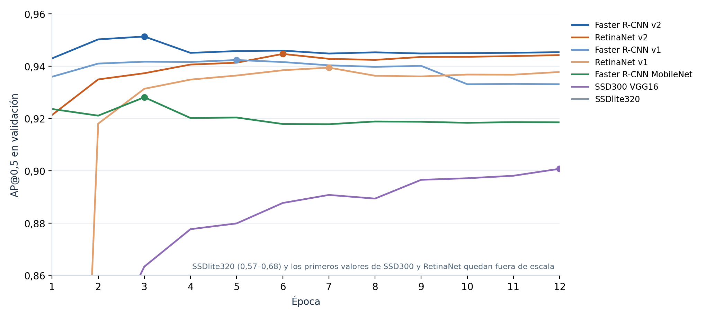
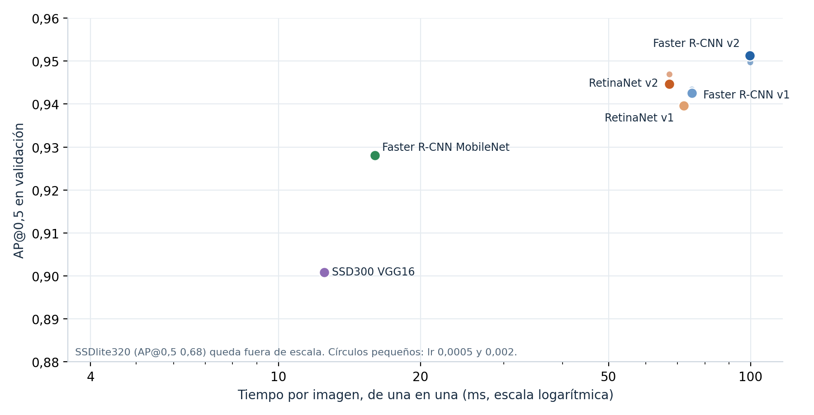
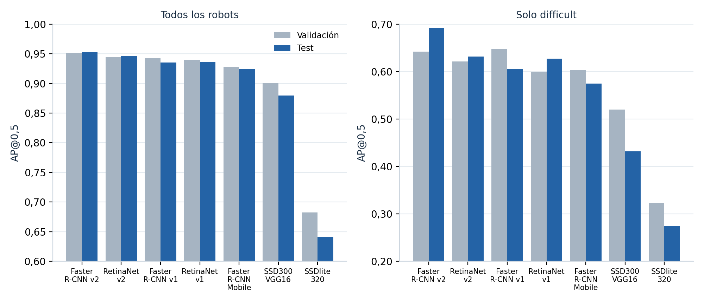

# Memoria del proyecto Fase 2

Autores: Javier Saguar, Alejandro Cuevas, Mónica Fernández, Pedro José Orrego, Daniel Naval

Contenido actualizado el 16 de octubre de 2026. Grupo 2 según el usuario pids2; confirmar identificación administrativa y fecha de entrega.

## Respuesta a la revisión anterior

No aplica a la primera entrega. No hay comentarios docentes incorporados en esta versión de trabajo.

## Reparto del trabajo

Distribución documentada en los commits y tareas. La participación final se revisará en grupo antes de entregar.

| Integrante | Datos y análisis | Entrenamiento y evaluación |
| --- | --- | --- |
| Javier Saguar | Organización, extracción, lote A, revisión, depuración, aumento y ampliaciones del EDA | Experimentos en laboratorio, evaluación y memoria |
| Alejandro Cuevas | Lote B, revisión de C y EDA | Adaptación de train/test y propuestas de mejora |
| Mónica Fernández | Lote C y calibración | Pendiente de consolidar reparto |
| Pedro José Orrego | Lote D, calibración y selección de figuras | Pendiente de consolidar reparto |
| Daniel Naval | Lote E y calibración | Pendiente de consolidar reparto |

Tabla 1. Reparto provisional del trabajo documentado.

## Índice

## 7. El pipeline de entrenamiento

Se entrena sobre 3184 imágenes con aumento base o sobre las 796 originales. Validación contiene 672 imágenes de 11 secuencias externas, con 1561 robots, 255 difficult y ningún negativo. Test contiene 718 imágenes de 13 secuencias externas, con 1721 robots y 270 difficult, y se reservó para evaluar una sola vez cada modelo final, sin usarlo para elegir nada (apartado 11.9).

Figura 1. Flujo realmente usado para ajustar pesos y seleccionar el checkpoint con validación.

La imagen se carga en RGB, se pasa a tensor en [0,1] y el modelo normaliza y escala internamente. Los primeros experimentos usan lote físico 8; res1024 acumula dos microbatches de 4 antes de actualizar. Una época recorre todo entrenamiento. Se suman las pérdidas de RPN, clasificación y regresión; SGD actualiza los pesos mediante retropropagación.

Las cajas difficult también participan en el entrenamiento: sin_difficult elimina el flag del diccionario que se entrega al detector, no sus cajas. Para la pérdida de validación se usa no_grad; para las detecciones y AP, eval. Cada época se guarda model_last y solo se reemplaza model_best cuando sube AP@0,5.

## 8. Modelos

Se ha probado Faster R-CNN ResNet-50 con FPN [3,4], una red de dos etapas: el RPN propone regiones y la cabeza clasifica y ajusta sus cajas. Se inicializa con COCO y se sustituye la cabeza por fondo y robot. FPN combina escalas, relevante para objetivos a distancias diferentes. Los apartados 11.7 a 11.9 comparan siete arquitecturas: además de esta, Faster R-CNN v2 y una variante con MobileNet, RetinaNet [6] y SSD [7].

Los resultados de COCO no predicen la ganancia en nuestros datos, por eso la comparación mide precisión y también latencia, que es lo que condiciona el uso en el robot.

## 9. Hiperparámetros

| Parámetro | Valor aplicado |
| --- | --- |
| Épocas / lote efectivo / semilla | 30 / 8 / 0; res1024: microbatch 4 × 2 |
| Optimizador | SGD; momentum 0,9; weight decay 0,0005 |
| Tasa inicial | 0,0001 en originales; 0,001 en lr001 y res1024 |
| Programador | ReduceLROnPlateau con pérdida de validación |
| Bajada / paciencia / mínimo | ×0,1 / 5 épocas / 1e−10 |
| Resolución del detector | 800/1333; res1024: 1024/1820 |
| Datos aumentados | Originales y 3 copias; mismo aumento base |
| Checkpoint seleccionado | Mayor AP@0,5 en validación |
| Entorno | PyTorch 2.4.1; torchvision 0.19.1; RTX 3060 12 GB |

Tabla 2. Configuración común de los experimentos medidos.

La tasa 0,001 se ensayó como salto de diez veces manteniendo los otros parámetros. En estos cuatro experimentos no se añadieron warmup, otra arquitectura ni los perfiles nuevos de aumento: cambiar una variable facilita interpretar el resultado, aunque una sola semilla no mide su variabilidad. La comparación de los apartados 11.7 a 11.9 sí cambia de arquitectura y usa el perfil robusto_v1, con 12 épocas y lote efectivo 8; Faster R-CNN v2 acumula microlotes de 4 por falta de memoria.

## 10. Métricas

IoU es la intersección entre caja predicha y real dividida por su unión. Con IoU≥0,5 y confianza≥0,5 se emparejan detecciones por confianza: acierto TP, detección sin pareja FP y robot sin pareja FN. Precisión es TP/(TP+FP), exhaustividad TP/(TP+FN) y F1 la media armónica de ambas.

AP resume la curva precisión–exhaustividad al variar confianza. AP@0,5 fija IoU en 0,5; AP@0,75 exige cajas más ajustadas; AP 0,50:0,95 promedia umbrales de IoU de 0,50 a 0,95. Al haber una clase, la media entre clases coincide con su AP. En los grupos normales/difficult se ignoran las anotaciones y detecciones emparejadas del otro grupo.

AP small usa la categoría de área de COCO, no el criterio de ancho <30 px de nuestra anotación. El AP de grupos y el recall a confianza fija responden a preguntas distintas. Además, las etiquetas incompletas de validación pueden penalizar detecciones correctas como FP; no se interpreta el recuento como error visual confirmado.

## 11. Experimentos

### 11.1. Comparación del aumento y de la tasa

| Experimento | Mejor época | AP50 historial | AP50 evaluación | AP evaluación |
| --- | --- | --- | --- | --- |
| Sin aumento lr 0,0001 | 20 | 0,9229 | 0,9228 | 0,5809 |
| Aumento base lr 0,0001 | 29 | 0,9425 | 0,9416 | 0,6081 |
| Aumento base lr 0,001 | 5 | 0,9432 | 0,9433 | 0,6302 |
| lr 0,001 res1024 | 2 | 0,9464 | 0,9465 | 0,6047 |

Tabla 3. Mejor checkpoint por AP50. AP sin sufijo es AP 0,50:0,95. El historial y la evaluación final se mantienen separados.

El aumento base mejora especialmente difficult: AP50 de 0,5518 a 0,6341. La comparación a igual número de épocas incluye cuatro veces más imágenes y actualizaciones con aumento; no permite atribuir toda la diferencia solo a las transformaciones. La ejecución con lr001 conserva ese mismo conjunto de 3184 imágenes.

Figura 2. Pérdidas y AP por época. Los puntos señalan los checkpoints elegidos por AP50.

Con lr001 se alcanza AP50=0,943169 en la época 5; la referencia llega a 0,942506 en la 29. Es aprendizaje más rápido y solo +0,066 puntos en el mejor AP50 del historial. La ejecución completa terminó el 15/10 a las 22:13, incluida la validación, con salida 0.

### 11.2. Curvas y resultado del cambio de tasa

La pérdida de validación mínima aparece en la época 4, 0,221198, y sube hasta 0,241296 en la 30 mientras la de entrenamiento baja a 0,065661. El AP50 final cae a 0,933178. Hay indicios de sobreajuste después del óptimo temprano: se conserva model_best de la época 5 y no model_last.

Figura 3. Tasa usada en cada época. Las bajadas de ReduceLROnPlateau no recuperan el óptimo temprano.

En lr001 se usa 0,001 en épocas 1–10, 0,0001 en 11–16, 0,00001 en 17–22, 0,000001 en 23–28 y 0,0000001 en 29–30. La tasa del experimento con aumento original no bajó. Más épocas con esta ejecución no solucionaron la pérdida de validación.

| Métrica en validación | lr 0,0001 | lr 0,001 | Cambio pp |
| --- | --- | --- | --- |
| AP50 todos | 0,9416 | 0,9433 | +0,17 |
| AP 0,50:0,95 todos | 0,6081 | 0,6302 | +2,21 |
| AP75 todos | 0,7146 | 0,7460 | +3,14 |
| AP50 normales | 0,9664 | 0,9740 | +0,76 |
| AP50 difficult | 0,6341 | 0,6462 | +1,21 |
| AP small | 0,1074 | 0,1182 | +1,08 |

Tabla 4. Evaluación final de los mejores checkpoints con el mismo procedimiento y conjunto.

El cambio de tasa mejora sobre todo el ajuste de cajas. AP50 ya era alto y su incremento es pequeño. La ganancia modesta en objetos pequeños motivó el experimento de resolución de los apartados 11.5 y 11.6.

### 11.3. Errores umbral y coste de inferencia

| Confianza e IoU ≥0,5 | lr 0,0001 | lr 0,001 | res1024 |
| --- | --- | --- | --- |
| TP / FN | 1478 / 83 | 1478 / 83 | 1493 / 68 |
| FN normales / difficult | 20 / 63 | 18 / 65 | 12 / 56 |
| FP frente a etiquetas | 210 | 190 | 324 |
| Precisión | 0,8756 | 0,8861 | 0,8217 |
| Recall total | 0,9468 | 0,9468 | 0,9564 |
| Recall difficult | 0,7529 | 0,7451 | 0,7804 |
| F1 | 0,9098 | 0,9155 | 0,8840 |

Tabla 5. Recuento a un umbral fijo; no debe confundirse con el AP.

El cambio de tasa reduce 20 FP y detecta dos normales adicionales, pero pierde dos difficult más; el TP total no cambia. Que AP difficult suba a 0,6462 mientras baja su recall a confianza 0,5 es compatible: el AP recorre confianzas y también depende de la ordenación y las cajas.

Figura 4. Precisión exhaustividad y F1 de lr001 en la rejilla de confianzas de validación.

El mejor F1 muestreado pasa de 0,95 a 0,85 con lr001 y vuelve a 0,95 con res1024. La rejilla termina en 0,95 y no determina el óptimo exacto. A confianza 0,5, res1024 detecta 15 robots más, nueve difficult, pero añade 134 FP y reduce F1. La latencia individual sube de 75,1 a 121,6 ms; no incluye captura, red ni actuación.

### 11.4. Comparación por secuencia

| Secuencia | AP50 antes | AP50 lr001 | FN antes → después |
| --- | --- | --- | --- |
| 2023 GR04 0008 | 0,9876 | 0,9886 | 2 → 2 |
| 2024 GR02 0001 | 0,9393 | 0,9380 | 1 → 0 |
| 2024 GR02 0007 | 0,9877 | 0,9873 | 1 → 1 |
| 2024 GR02 0008 | 0,9864 | 0,9782 | 0 → 0 |
| 2024 GR04 0002 | 0,9817 | 0,9844 | 0 → 0 |
| 2024 GR04 0003 | 0,8131 | 0,8096 | 6 → 6 |
| 2025 GR01 0002 | 0,9719 | 0,9775 | 2 → 3 |
| 2025 GR01 0010 | 0,9049 | 0,9404 | 4 → 1 |
| 2025 GR03 0007 | 0,9661 | 0,9678 | 8 → 9 |
| 2025 GR03 0011 | 0,8465 | 0,8473 | 30 → 28 |
| 2025 GR04 0011 | 0,9280 | 0,9290 | 29 → 33 |

Tabla 6. Secuencias de validación comparadas con las mismas etiquetas.

Figura 5. Cambio de AP50 por secuencia en puntos porcentuales.

AP50 mejora en 7 de 11 secuencias y baja en 4. GR01_0010 de 2025 gana 3,55 puntos y reduce sus FN de 4 a 1. En GR04_0011 de 2025 aumentan de 29 a 33 los FN y de 25 a 28 los difficult perdidos. GR04_0003 de 2024 sigue perdiendo sus seis difficult; el cambio de tasa no resuelve ese caso.

### 11.5. Resolución y evolución del entrenamiento

La propuesta de Alejandro se ejecutó desde COCO con lr=0,001 y aumento base, elevando min_size/max_size de 800/1333 a 1024/1820. Un frame pasa aproximadamente de 1333 × 750 a 1820 × 1024, un 86 % más de píxeles. Para memoria se usaron microbatch 4 y acumulación 2, frente a lote físico 8. No son idénticos numéricamente: pueden cambiar propuestas y redondeos.

Figura 6. Misma semilla y datos. Los puntos marcan el máximo AP50 de cada historial, no el máximo AP promedio.

El mejor AP50 de res1024 es 0,946440 en la época 2. Su AP 0,50:0,95 es 0,605390; el máximo de esta otra métrica aparece en la época 5, con 0,632233 y AP50 0,942070. Se respeta el criterio predefinido AP50 y se evalúa model_best de la época 2, sin seleccionar retrospectivamente por otra métrica.

La pérdida de validación mínima es 0,215909 en la época 3 y termina en 0,232343, mientras la de entrenamiento baja a 0,073149. El AP50 final cae a 0,933510. Hay indicios de sobreajuste y estancamiento tras el óptimo temprano. ReduceLROnPlateau usa 0,001 en 1–9, 0,0001 en 10–15, 1e−5 en 16–21, 1e−6 en 22–27 y 1e−7 en 28–30; no recupera el máximo.

Entrenamiento y validación finalizaron el 16/10 hacia las 08:45 Europe/Madrid, salida 0, unas nueve horas desde el lanzamiento. El máximo de 8482 MiB reservados corresponde al preflight, no a una medición del pico de las 30 épocas. Se conservan conjuntos, scheduler y aumento; no se ha evaluado test.

### 11.6. Resultado y coste de la resolución

| Mejor por AP50 en validación | lr001 800 | lr001 1024 | Cambio pp |
| --- | --- | --- | --- |
| AP50 todos | 0,9433 | 0,9465 | +0,32 |
| AP 0,50:0,95 todos | 0,6302 | 0,6047 | −2,55 |
| AP75 todos | 0,7460 | 0,6990 | −4,70 |
| AP50 difficult | 0,6462 | 0,6282 | −1,80 |
| AP small | 0,1182 | 0,1886 | +7,04 |
| AP large | 0,6919 | 0,6459 | −4,60 |

Tabla 7. Evaluación final del checkpoint seleccionado. El historial se presenta por separado.

Figura 7. La mejora de pequeños convive con retrocesos en otras métricas y mayor latencia individual.

La inferencia individual tarda 121,6 frente a 75,1 ms, +61,9 %, aproximadamente 8,2 frente a 13,3 imágenes/s solo de inferencia. En lote son 120,5 frente a 72,7 ms/imagen, pero con lotes distintos de 4 y 8. La comparación individual es más directa; ninguna cifra mide la demo completa.

Figura 8. Cambio de AP50 frente a lr001 a resolución original; escala en puntos porcentuales.

AP50 mejora en 4 secuencias, baja en 6 y empata en una. GR03_0011 de 2025 gana 4,16 puntos y reduce FN de 28 a 22. GR04_0011 de 2025 reduce FN de 33 a 25, pero FP sube de 28 a 58. GR01_0002 de 2025 pierde 1,20 puntos. GR04_0003 de 2024 sigue perdiendo sus seis difficult. El CSV complementario conserva todas las secuencias.

### 11.7. Comparación de arquitecturas

Se entrenaron las siete arquitecturas del código de partida, todas inicializadas con COCO y con la cabeza sustituida por fondo y robot: Faster R-CNN ResNet-50 FPN en sus versiones v1 y v2 y con MobileNetV3, RetinaNet ResNet-50 FPN (v1 y v2), SSD300 con VGG16 y SSDlite320 con MobileNetV3 [3,4,6,7]. Todas usan el perfil de aumento robusto_v1 (las 796 originales y tres copias por imagen), 12 épocas, SGD con tasa 0,001 y semilla 0, y se conserva el checkpoint con mayor AP@0,5 en validación.

| Modelo | Época | AP50 todos | AP50 normales | AP50 difficult | AP 0,50:0,95 | F1 máx. (umbral) | ms/imagen | Min |
| --- | --- | --- | --- | --- | --- | --- | --- | --- |
| Faster R-CNN v2 | 3 | 0,9513 | 0,9759 | 0,6422 | 0,6192 | 0,9361 (0,95) | 99,5 | 151 |
| RetinaNet v2 | 6 | 0,9447 | 0,9748 | 0,6213 | 0,6114 | 0,9264 (0,65) | 67,3 | 102 |
| Faster R-CNN v1 | 5 | 0,9426 | 0,9733 | 0,6471 | 0,6273 | 0,9305 (0,90) | 75,1 | 106 |
| RetinaNet v1 | 7 | 0,9396 | 0,9687 | 0,5994 | 0,6196 | 0,9229 (0,65) | 72,2 | 98 |
| Faster R-CNN MobileNet | 3 | 0,9281 | 0,9597 | 0,6027 | 0,5789 | 0,9167 (0,55) | 16,0 | 19 |
| SSD300 VGG16 | 12 | 0,9008 | 0,9404 | 0,5199 | 0,5144 | 0,8926 (0,25) | 12,5 | 19 |
| SSDlite320 | 7 | 0,6823 | 0,7272 | 0,3233 | 0,3943 | 0,6839 (0,20) | 4,2 | 6 |

Tabla 8. Siete arquitecturas con lr 0,001 en validación (672 imágenes, 1561 robots, 255 difficult). Época del mejor checkpoint; F1 máximo de la rejilla de umbrales de 0,05; milisegundos por imagen de una en una en la RTX 3060 sin captura ni actuación; minutos de entrenamiento.

Figura 9. AP@0,5 en validación por época. El punto marca el checkpoint elegido. Faster R-CNN llega a su máximo entre las épocas 3 y 5 y después pierde algo; RetinaNet mejora despacio y SSD300 sigue subiendo en la 12.

Faster R-CNN v2 es el más preciso, con AP@0,5 de 0,9513, seguido de RetinaNet v2 (0,9447), Faster R-CNN v1 (0,9426) y RetinaNet v1 (0,9396). La v2 supera a la v1 en 0,87 puntos y a RetinaNet v2 en 0,66: son diferencias pequeñas con una sola semilla, aunque la v2 queda por encima de RetinaNet v2 con las tres tasas ensayadas (apartado 11.8). Las cuatro redes con ResNet-50 quedan a 1,2 puntos entre sí: dentro de esa familia, la arquitectura cambia poco el AP@0,5.

Las redes ligeras pierden precisión. Faster R-CNN con MobileNet baja 2,3 puntos (0,9281), pero tarda 16,0 ms por imagen frente a 99,5 de la v2, unas seis veces menos. SSD300 (0,9008) es más rápida que cualquiera de las de ResNet-50, pero MobileNet le saca 2,7 puntos por 3,5 ms más: no compensa. SSDlite320 (0,6823) no sirve, porque reduce la imagen a 320 × 320 y los robots lejanos casi desaparecen.

Figura 10. Precisión frente a tiempo por imagen. Faster R-CNN con MobileNet es el mejor compromiso rápido; los círculos pequeños son las variantes de tasa.

Las curvas muestran dos comportamientos. Faster R-CNN alcanza el máximo en las épocas 3 a 5 y después pierde entre 0,6 y 1 punto mientras su pérdida de entrenamiento sigue bajando: sobreajuste temprano, como en los experimentos anteriores. RetinaNet arranca más despacio (RetinaNet v1 está en 0,48 en la primera época) pero es más estable y llega al máximo en las épocas 6 y 7. SSD300 sigue mejorando en la época 12, por lo que doce épocas pueden ser pocas para ese modelo; no se probó con más.

Los difficult siguen siendo el punto débil de todas las arquitecturas: su AP@0,5 queda entre 0,60 y 0,65, de 33 a 37 puntos por debajo del de los robots normales. Cambiar de arquitectura no cierra esa brecha; Faster R-CNN v1 (0,6471) y v2 (0,6422) son las que mejor los detectan.

### 11.8. Tasa de aprendizaje y perfil de aumento

| Modelo | lr | Mejor época | AP50 todos | AP50 difficult | AP 0,50:0,95 | Min |
| --- | --- | --- | --- | --- | --- | --- |
| Faster R-CNN v2 | 0,0005 | 5 | 0,9507 | 0,6361 | 0,6126 | 189 |
| Faster R-CNN v2 | 0,0010 | 3 | 0,9513 | 0,6422 | 0,6192 | 151 |
| Faster R-CNN v2 | 0,0020 | 1 | 0,9497 | 0,6223 | 0,6403 | 151 |
| RetinaNet v2 | 0,0005 | 11 | 0,9451 | 0,6133 | 0,6170 | 126 |
| RetinaNet v2 | 0,0010 | 6 | 0,9447 | 0,6213 | 0,6114 | 102 |
| RetinaNet v2 | 0,0020 | 6 | 0,9469 | 0,6246 | 0,6177 | 101 |
| Faster R-CNN v1 | 0,0005 | 14 | 0,9420 | 0,6323 | 0,6104 | 132 |
| Faster R-CNN v1 | 0,0010 | 5 | 0,9426 | 0,6471 | 0,6273 | 106 |
| Faster R-CNN v1 | 0,0020 | 2 | 0,9434 | 0,6465 | 0,6024 | 105 |

Tabla 9. Variación de la tasa de aprendizaje en los tres modelos con mejor AP@0,5 en validación. Con 0,0005 se entrenaron 15 épocas; con 0,001 y 0,002, 12.

Con los tres mejores modelos se repitió el entrenamiento con tasas de 0,0005 y 0,002. La tasa casi no cambia el AP@0,5: entre la mejor y la peor variante hay 0,16 puntos en Faster R-CNN v2 (0,9497 a 0,9513), 0,22 en RetinaNet v2 (0,9447 a 0,9469) y 0,14 en Faster R-CNN v1 (0,9420 a 0,9434), lo que cabe esperar de cambiar la semilla. No hay razón para preferir otra tasa que 0,001, que además necesita menos épocas que 0,0005.

Lo que sí cambia es la estabilidad. Con 0,002, Faster R-CNN alcanza su máximo en la primera o la segunda época y después pierde entre 1,1 y 1,4 puntos: de 0,9497 a 0,9355 en la v2 y de 0,9432 a 0,9320 en la v1. Con 0,0005 el máximo llega más tarde (época 5 en la v2) y la caída posterior es de 0,5 puntos. RetinaNet v2 es poco sensible a la tasa. Que el mejor checkpoint con lr 0,002 sea el de una sola época indica que apenas se ha entrenado, y recuerda que cada cifra es el máximo de una curva y por tanto algo optimista.

El perfil robusto_v1 (sombras y llovizna en los exteriores, obstáculos con textura y refuerzo de las imágenes con difficult; apartado 6.1) se comparó con el aumento base repitiendo Faster R-CNN v1 con lr 0,001: AP@0,5 de 0,9426 con robusto_v1 y 0,9433 con el aumento base; 0,6471 y 0,6462 en difficult; 191 y 190 falsos positivos y 84 y 83 robots perdidos con confianza 0,5. No hay diferencia medible, y el mejor checkpoint cae en la época 5 en los dos casos. La comparación no es idéntica (30 épocas con el aumento base y 12 con robusto_v1), pero sí lo es en el checkpoint elegido.

Que no mejore no prueba que no sirva: la lluvia sintética, las sombras locales y los obstáculos con textura no se han podido medir por separado, y no hay una serie de lluvia real que los contraste. Con estos datos el perfil base es suficiente y robusto_v1 no se adopta como mejora.

### 11.9. Evaluación final en test

El criterio se fijó antes de abrir el test y quedó registrado en el repositorio (docs/seleccion_modelo_final.md, 24/10/2026): el modelo final es el de mayor AP@0,5 en validación, el umbral de confianza es el de mejor F1 en validación, y se evalúan en test los siete modelos con lr 0,001, una sola vez cada uno. El test tiene 718 imágenes de 13 secuencias de otros grupos, con 1721 robots (270 difficult). No se ha usado para elegir nada.

| Modelo | AP50 val. | AP50 test | Diff. val. | Diff. test | AP 0,5:0,95 test | Umbral | Precis. | Exhaust. | F1 | FP / FN |
| --- | --- | --- | --- | --- | --- | --- | --- | --- | --- | --- |
| Faster R-CNN v2 | 0,9513 | 0,9523 | 0,6422 | 0,6921 | 0,5724 | 0,95 | 0,9447 | 0,9332 | 0,9389 | 94 / 115 |
| RetinaNet v2 | 0,9447 | 0,9457 | 0,6213 | 0,6313 | 0,5609 | 0,65 | 0,9409 | 0,9064 | 0,9233 | 98 / 161 |
| Faster R-CNN v1 | 0,9426 | 0,9355 | 0,6471 | 0,6057 | 0,5700 | 0,90 | 0,9224 | 0,9250 | 0,9237 | 134 / 129 |
| RetinaNet v1 | 0,9396 | 0,9362 | 0,5994 | 0,6273 | 0,5711 | 0,65 | 0,9226 | 0,9210 | 0,9218 | 133 / 136 |
| Faster R-CNN MobileNet | 0,9281 | 0,9240 | 0,6027 | 0,5744 | 0,5335 | 0,55 | 0,9145 | 0,9140 | 0,9142 | 147 / 148 |
| SSD300 VGG16 | 0,9008 | 0,8797 | 0,5199 | 0,4316 | 0,4788 | 0,25 | 0,9128 | 0,8216 | 0,8648 | 135 / 307 |
| SSDlite320 | 0,6823 | 0,6412 | 0,3233 | 0,2742 | 0,3472 | 0,20 | 0,7284 | 0,5985 | 0,6571 | 384 / 691 |

Tabla 10. Evaluación final en test, una vez por modelo, con el umbral fijado en validación. Precisión, exhaustividad, F1 y recuento de falsos positivos y robots perdidos a ese umbral; AP50 en todos los robots y en difficult.

Figura 11. AP@0,5 en validación y en test. El orden de las arquitecturas se mantiene; las de SSD pierden más al pasar a test.

El modelo final, Faster R-CNN v2 con lr 0,001, obtiene en test un AP@0,5 de 0,9523 (0,9513 en validación): 0,9658 en robots normales y 0,6921 en difficult. Con el umbral 0,95 detecta 1606 de los 1721 robots (exhaustividad 0,9332, y 0,7259 en difficult), con 94 falsos positivos (precisión 0,9447) y un F1 de 0,9389. El mejor F1 posible en test sería 0,9413, con umbral 0,90: el umbral elegido en validación queda a 0,24 puntos del óptimo.

Las cifras de test son coherentes con las de validación. El orden se mantiene salvo el intercambio entre RetinaNet v1 y Faster R-CNN v1, a solo 0,07 puntos (0,9362 y 0,9355). Las redes con ResNet-50 varían entre −0,7 y +0,1 puntos al pasar a test, mientras que las de SSD pierden más (2,1 puntos SSD300 y 4,1 SSDlite320). En difficult, el modelo final sube 5,0 puntos (de 0,6422 a 0,6921) y Faster R-CNN v1 y MobileNet bajan 4,1 y 2,8; con 270 robots, cambios de unos pocos puntos no son concluyentes.

Por secuencias, 11 de las 13 superan 0,94 de AP@0,5 con el modelo final. Las excepciones son PIDS2025_GR02_0009 (0,8695, con 40 robots perdidos de 204, 33 de ellos difficult) y PIDS2025_GR04_0000 (0,4967), una secuencia de 13 imágenes y 21 robots en la que se pierden 10, y que pesa poco por su tamaño.

La opción rápida para la demo, Faster R-CNN con MobileNet, obtiene 0,9240 en test (0,5744 en difficult) y un F1 de 0,9143 con el umbral 0,55, a 16,0 ms por imagen frente a 96,3 del modelo final. Los límites son los de siempre: una sola semilla, etiquetas de otros grupos con criterios algo distintos (antenas, robots cortados) y latencias de inferencia en la RTX 3060 sin captura ni actuación. No se ha medido nada en el robot.

## 12. Análisis cualitativo

La inspección de las predicciones distingue errores del detector y carencias de las etiquetas. En la figura siguiente se ven cuatro robots, pero el XML de GR02_0001/frame_0444 de 2024 contiene una sola caja. Una detección correcta de los otros tres puede contarse como FP. No se modifican las etiquetas para conservar la comparación.

Figura 12. Caso confirmado de anotación incompleta. La caja azul es la única del XML.

Esto limita la interpretación de los 190 FP de lr001 y los 324 de res1024, y de precisión, F1 y AP. No se ha cuantificado la extensión del problema ni se atribuyen todos los FP a omisiones. GR02_0001 pasa de 49 a 71 FP frente a etiquetas; no son necesariamente errores visuales nuevos.

Figura 13. Res1024 en PIDS2025_GR03_0011/frame_0600: TP 4, FP 4 y FN 1 frente a las etiquetas; rojo indica detección sin pareja.

La muestra de res1024 incluye una caja roja sobre una pierna y varias cajas solapadas en torno a un objetivo: las etiquetas omitidas no explican todos los errores. Los difficult concentran 65/83 FN de lr001 y 56/68 de res1024. Su recall al umbral 0,5 mejora, pero no su AP50 agregado; el flag agrupa tamaños, oclusión y movimiento.

### 12.1. Conclusiones y trabajo pendiente

El modelo final es Faster R-CNN v2 con lr 0,001 y el perfil robusto_v1, checkpoint de la época 3: AP@0,5 de 0,9523 en test (0,9658 en robots normales y 0,6921 en difficult) y F1 de 0,9389 con el umbral 0,95 fijado en validación. La opción rápida es Faster R-CNN con MobileNet, con 0,9240 en test y 16,0 ms por imagen frente a 96,3. Elegir entre las dos depende de la latencia real que admita el robot, que está por medir.

De la comparación salen cuatro conclusiones. La arquitectura importa más que la tasa de aprendizaje y que el aumento: las cuatro redes con ResNet-50 quedan a 1,2 puntos entre sí, la tasa mueve el AP@0,5 menos de 0,25 puntos y el perfil robusto_v1 no mejora al aumento base. Los difficult siguen siendo el punto débil de todas, con un AP@0,5 de test entre 0,57 y 0,69, de 27 a 37 puntos por debajo del de los robots normales. Las redes con entrada pequeña (SSD) no sirven para robots lejanos. Y Faster R-CNN sobreajusta pronto con cualquier tasa, por lo que el checkpoint se elige por validación y no por el final del entrenamiento.

La referencia de los primeros experimentos (Faster R-CNN v1, lr 0,001, resolución 800/1333) queda como línea base. La resolución 1024 se probó solo con Faster R-CNN v1, donde aportó +7,04 puntos de AP small y 15 robots menos perdidos a costa de más falsos positivos y 62 % más de latencia; no se ha probado con Faster R-CNN v2. La selección por AP50 tiene sus consecuencias: en res1024 el máximo AP 0,50:0,95 del historial está en la época 5, no en la 2 elegida, y no se ha reevaluado otro checkpoint.

Queda por hacer: mejorar los difficult, para lo que el aumento dirigido probado aquí no basta (más imágenes reales con movimiento y oclusión, o combinar resolución mayor con Faster R-CNN v2); repetir con varias semillas para acotar la variabilidad; y llevar el modelo al robot, medir la latencia de toda la cadena (captura, detección y actuación) y decidir entonces entre el modelo final y el rápido. Eso corresponde al Bloque 3; esta fase queda como un avance.

## Referencias

[1] labelImg. Herramienta de anotación PascalVOC. https://github.com/HumanSignal/labelImg

[2] Albumentations 1.4.18. Código de transformaciones. https://github.com/albumentations-team/albumentations/tree/1.4.18

[3] S. Ren et al. Faster R-CNN Towards Real-Time Object Detection with Region Proposal Networks. 2015. https://arxiv.org/abs/1506.01497

[4] torchvision 0.19. Faster R-CNN ResNet-50 FPN. https://docs.pytorch.org/vision/0.19/models/generated/torchvision.models.detection.fasterrcnn_resnet50_fpn.html

[5] Repositorio del grupo. Datos, criterios, notebooks y resultados. https://github.com/javiersaguar/PIDS-Proyecto2

[6] T.-Y. Lin et al. Focal Loss for Dense Object Detection. 2017. https://arxiv.org/abs/1708.02002

[7] W. Liu et al. SSD: Single Shot MultiBox Detector. 2016. https://arxiv.org/abs/1512.02325

Los originales, XML, exclusiones y manifiestos están en el repositorio. Los HTML del EDA son material complementario; las figuras del cuerpo son exportaciones estáticas. Los experimentos y tablas de esta versión se han medido en validación, salvo las comprobaciones de integridad del aumento.
